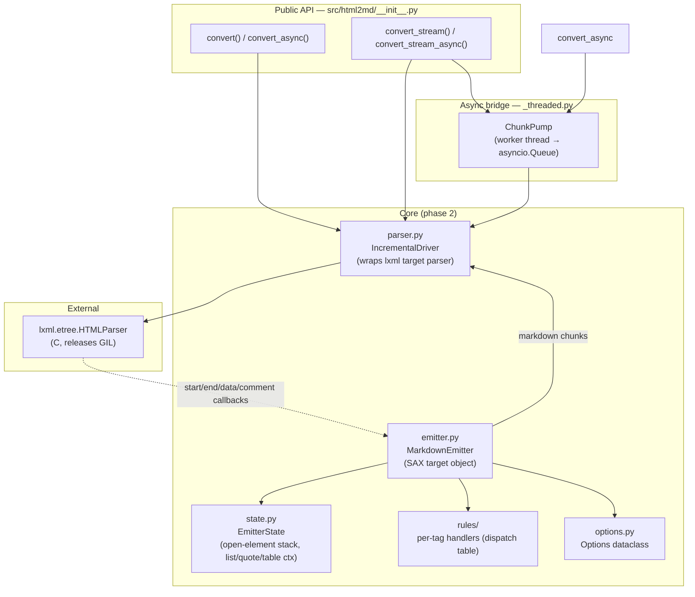
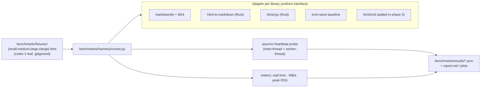
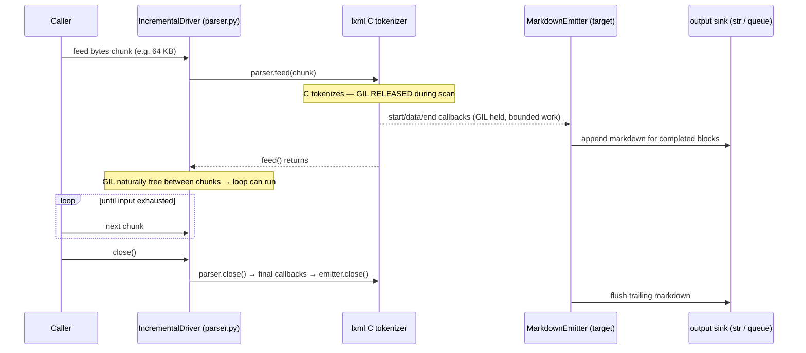
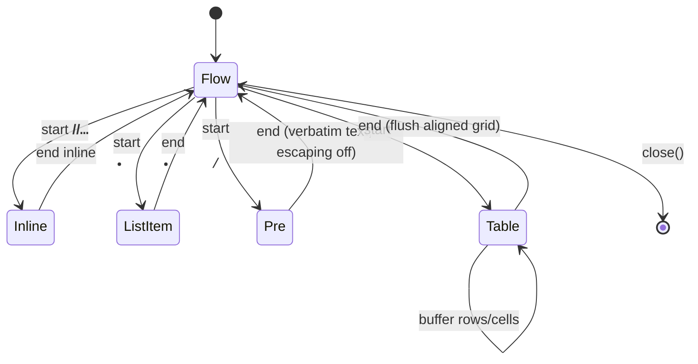
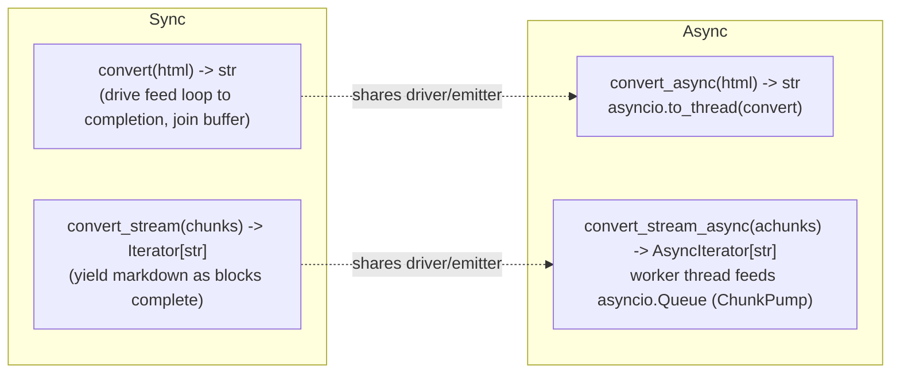

# html2md — Design Doc

> Fast, streaming HTML → Markdown conversion for Python, built on **lxml** (C, releases
> the GIL) instead of BeautifulSoup. Drop-in replacement for `markdownify` that parses
> large HTML incrementally — like a browser — and emits Markdown in chunks without
> stalling the asyncio event loop.

Status: **draft, pre-implementation.** Covers all three project phases. Companion docs:
`docs/test-plan.md` (black-box / comparison / load / manual QA test harness) and
`docs/research.md` (corpus + fixture sourcing, owned by coder-1-leaf, bead `zo-1fp.3`).

---

## 1. Summary

`markdownify` is BeautifulSoup-based. On large inputs it is slow, and — more importantly
for our workload — it is **pure Python**, so it holds the GIL for the entire conversion.
When a conversion runs inside an async request handler (even on a worker thread via
`run_in_executor`), a GIL-bound conversion stalls every other coroutine on the event
loop: health checks time out, SSE streams stutter, unrelated requests queue.

This project replaces it in three phases:

- **Phase 1 — Measure.** Build a benchmark harness that pits the incumbent
  (`markdownify`+BS4) against a Rust crate with Python bindings and against a naive
  `lxml` baseline, across input sizes from ~10 KB to ~100 MB. We measure not just speed
  (wall time, throughput, peak RSS) but the property we actually care about: **how badly
  each library stalls a live asyncio event loop**, on the main thread and on a worker
  thread. This phase *empirically decides whether phase 2 is even necessary.*

- **Phase 2 — Build (conditional).** If no existing library is both fast *and*
  event-loop-friendly, build `html2md`: a streaming converter driven by lxml's
  incremental **target parser**, structured so the longest contiguous GIL-hold is bounded
  by a chunk, not by the document. Public sync + async APIs, validated against a layered
  HTML→Markdown conformance corpus.

- **Phase 3 — Compare.** Re-run the phase-1 harness with `html2md` added as a fourth
  contender and a conformance/quality comparison against every prior implementation.
  Acceptance gates decide whether we ship.

### Key decisions & non-obvious properties

1. **The metric that matters is scheduling latency, not throughput.** A library can be
   fast and still be unusable in async code if it holds the GIL in one long burst. The
   phase-1 probe (§3.3) is the centerpiece, not an afterthought.

2. **Target parser, not DOM.** Phase 2 uses `lxml.etree.HTMLParser(target=…)` —
   SAX-like, push-based, **no element tree is ever built**. Memory is O(open-element
   depth), not O(document). This is what makes 100 MB inputs safe and what lets us
   interleave parse and emit so the GIL is released between chunks.

3. **The emitter is a deterministic pushdown transducer** over the SAX event stream (see
   §6.4 / §9 Alien Artifacts). Framing it this way gives us the central correctness
   property for free: **chunk-boundary invariance** — feeding the same bytes split at any
   set of offsets yields byte-identical output. This is the single most important
   invariant and is the backbone of the test harness.

4. **Drop-in option compatibility with `markdownify`.** The `Options` surface (§6.3)
   mirrors markdownify's keyword options where they have a sensible equivalent, so the
   incumbent can be swapped out at call sites with minimal churn.

5. **GIL release is structural, not incidental.** lxml's C tokenizer releases the GIL
   while scanning a fed buffer; our Python target callbacks reacquire it but run for a
   bounded, short time per chunk. The async path drives `feed()` on a worker thread so the
   event loop runs during the C-side scan and during the gaps between chunks.

---

## 2. Architecture

### 2.1 Component diagram



### 2.2 Phase-1 harness (separate from the library)



---

## 3. Phase 1 — Benchmark harness & GIL/async probe

The harness lives in `benchmarks/` and is a standalone tool, **not** part of the shipped
`html2md` package (it must run even before phase 2 exists). It is the instrument that
decides whether phase 2 is built.

### 3.1 Libraries under test

Each library is wrapped in an **adapter** that normalizes its native call shape behind one
uniform method: `adapter.convert(html_bytes: bytes) -> str`. The native shapes were
smoke-tested by coder-3-leaf (`docs/rust-candidate-smoke.md`); pinned versions come from
coder-1-leaf's research (`docs/research.md`). All candidates install via the
`[dependency-groups].benchmark` group so the shipped package depends only on `lxml`.

| Adapter | Package | Native call (normalized in adapter) | Engine | GIL during convert | Notes |
|---|---|---|---|---|---|
| `markdownify` | `markdownify>=0.13` + `beautifulsoup4` | `markdownify(html)` | Pure Python (BS4) | **Held throughout** | Incumbent / primary correctness oracle |
| `html_to_markdown` | `html-to-markdown==3.5.7` (Rust `html-to-markdown-rs`) | `html_to_markdown.convert(html).content` | Rust, abi3 wheel | Released *iff* bindings call `allow_threads` — **to be measured** | Primary Rust candidate. Pinned to 3.5.7 (released 2026-05-29), **not** the newest 3.6.13 — 3.6.13 shipped 2026-06-17 and is inside the 7-day supply-chain cooldown |
| `htmd_py` | `htmd-py==0.1.2` (Rust `htmd`) | `htmd.convert_html(html)` | Rust | To be measured | Turndown-inspired comparison |
| `html2text_rs` | `html2text_rs==0.2.5` (rust-html2text) | `html2text_rs.text_markdown(html)` | Rust | To be measured | Secondary Rust point of comparison |
| `lxml_naive` | `lxml>=5.0` | `lxml.html.fromstring` + recursive walk | C parse + Python tree walk | Released during C parse only; **held during the Python walk** | Establishes the "lxml without streaming" baseline that motivates phase 2 |

All adapters take/return the same `bytes → str` contract; the adapter is responsible for any
decode and for extracting the string from a wrapper type (e.g. `ConversionResult.content`).

`fast-html2md==0.2.0` is **excluded as a core engine**: coder-1-leaf found it is a Python
wrapper around BS4/tiktoken, not a native converter. It may be recorded as a footnote but
is not a contender. Per rubric pt 10, `docs/research.md` records for each candidate: license,
maintained-wheel availability (abi3/platform coverage), source pin, and whether it exposes
any streaming/options surface comparable to markdownify.

> Each adapter declares whether it supports being called on a worker thread safely. All
> listed do; the probe (§3.3) runs every adapter in both placements regardless.

#### 3.1.1 Apples-to-apples option normalization (reviewer-leaf P1 #3)

The candidates have **different defaults** (heading style, emphasis char, `<br>` handling,
table behavior), so benchmarking each at its *default* settings would confound semantics
with performance — a lib could look faster only because it does less. Before timing, each
adapter is configured **as close as its option surface allows to the markdownify-compatible
output contract** (design §5.1): ATX-vs-setext headings, `*` emphasis, two-space `<br>`,
fenced code, autolinks. The mapping is recorded explicitly per adapter in
`benchmarks/harness/adapters/<name>.py` (an `OPTION_MAP` documenting the chosen kwargs and
the contract dimension each one targets).

Where a candidate **cannot** be normalized to the contract (e.g. `html2text_rs` emits
text-oriented output that drops bold; htmd-py lacks a setext option), the adapter records the
**residual divergence** in its `OPTION_MAP.residual` field, and the report presents that
library on **two explicitly separated axes** — performance/GIL *and* a semantic-distance
score vs the oracle — never as a single "is it better" number. A fast converter that
produces different Markdown is reported as fast *and* divergent, not conflated. This keeps
the phase-1 comparison meaningful (rubric pt 10).

### 3.2 Input corpus & sizes

Fixtures are generated by coder-1-leaf (`benchmarks/fixtures/`, gitignored, regen command
in `docs/research.md`) from real pages (Wikipedia / gov / RFC-style), concatenated in
deterministic chunks to hit target sizes:

Sizes per `docs/research.md` (real corpus: Wikipedia HTML / United States, RFC 9110, a
~36 MiB NASA Apollo page, repeated deterministically to exact byte targets):

| Tier | Target size | Purpose |
|---|---|---|
| `small` | ~100 KiB | Realistic single article; per-call overhead dominates |
| `medium` | ~5 MiB | Typical large document |
| `large` | ~50 MiB | Stress; where the Python tree-walk cost shows |
| `xlarge` | ~100 MiB | Memory + sustained GIL-hold stress; the case that motivates streaming |

Plus a small set of **synthetic pathological** fixtures generated by
`benchmarks/harness/synth.py` (committed, deterministic, tiny): deep nesting (10 k levels),
very wide tables (1 k columns), link-dense text, CDATA/comment-heavy, and declared-but-wrong
encodings. These exercise worst-case emitter paths and recovery, independent of the large
real fixtures.

### 3.3 The async-yield / GIL-release probe — the decisive measurement

This is the core of phase 1. While a conversion runs, a background asyncio coroutine acts
as a **heartbeat**: it loops `await asyncio.sleep(INTERVAL)` (e.g. `INTERVAL = 5 ms`) and
records, for each tick, the *actual* elapsed wall time. With nothing competing, each tick
takes ≈ `INTERVAL`. If the converter holds the GIL, the loop cannot wake on time and the
**scheduling delay** (`actual − INTERVAL`) spikes. Scheduling delay is a direct,
quantitative proxy for "how much this conversion would hurt a live server."

Two placements, run for every (adapter × fixture):

```mermaid
sequenceDiagram
  participant Loop as Event loop (heartbeat coro)
  participant Conv as Conversion

  Note over Loop,Conv: Placement A — conversion ON the event-loop thread
  Conv->>Conv: convert() runs inline in a coroutine
  Loop--xLoop: heartbeat starved for the whole convert (worst case)

  Note over Loop,Conv: Placement B — conversion on a WORKER thread
  Loop->>Conv: await loop.run_in_executor(convert)
  alt engine releases GIL (lxml C scan / Rust allow_threads)
    Loop->>Loop: heartbeat keeps ticking ~on time
  else engine holds GIL (pure-Python markdownify)
    Loop--xLoop: heartbeat still starved despite worker thread
  end
```

- **Placement A (main thread):** conversion runs inline inside a coroutine. This is the
  worst case and the control — *any* CPU-bound work starves the loop here. Confirms the
  probe is calibrated (delay ≈ conversion time).
- **Placement B (worker thread):** conversion dispatched via `loop.run_in_executor`. Now
  the heartbeat stalls **only to the extent the engine holds the GIL**. This is the
  discriminating measurement: a Rust/lxml engine that releases the GIL keeps the heartbeat
  smooth; markdownify stalls it regardless of the thread.

**Probe metrics** (per run): max scheduling delay, p50/p95/p99 delay, total stall time
(Σ delay above a threshold), missed-beat count (ticks delayed > 2×INTERVAL), and the
longest single contiguous stall (the "max GIL-hold" estimate).

#### 3.3.1 Stage decomposition — do not overclaim parse-only (rubric pt 7, CRITICAL)

lxml releases the GIL **only during the C tokenizer scan**. The Python-side work that
follows — iterating the event stream and emitting Markdown — *reacquires* it. Benchmarking
"lxml parse" in isolation would prove the parser is async-friendly while saying nothing
about the whole library, which is the actual deliverable. The probe therefore measures the
`lxml_naive` and (in phase 3) `html2md` paths in **three separately instrumented stages**,
each run under the heartbeat:

| Stage | What runs | Expected GIL behavior |
|---|---|---|
| **S1 — parse only** | feed bytes to lxml, build/clear tree, discard output | GIL released during C scan → heartbeat smooth on worker thread |
| **S2 — parse + event iteration** | parse + walk every node (no Markdown emitted) | GIL reacquired for the Python walk → heartbeat degrades |
| **S3 — parse + iterate + emit** | full conversion to Markdown string | worst Python-side hold; the number that actually matters |

Reporting all three makes the GIL claim falsifiable and pinpoints *where* the hold lives —
for the streaming design (§4.2) the goal is that S3 on a worker thread stays close to S1
because emission is interleaved per chunk rather than done in one post-parse pass. The
one-shot Rust/markdownify adapters have no meaningful sub-stages (they are opaque
`bytes→str` calls) and are measured whole, but always in both placements.

**Baselines / controls** (validate the probe itself, and bound the claim), in
`benchmarks/harness/probe.py`:

- **Negative control — direct on loop:** every adapter also run inline on the event-loop
  thread (placement A); heartbeat delay must ≈ conversion time, proving the probe detects a
  stall at all.
- **Pure-Python CPU burner:** a busy-loop of known duration; in placement B it must show
  ≈ that delay, proving GIL-*hold* is detected (this is the markdownify-shaped control).
- **`time.sleep()` sleeper:** an equal-duration C sleep; in placement B it must show
  ~zero delay, proving GIL-*release* is detected (the ideal-engine control).
- **CPU + sleep mix:** alternating compute/sleep, to confirm the probe resolves *partial*
  GIL occupancy (the realistic middle ground), not just all-or-nothing.

Without these four, the probe numbers are unfalsifiable.

### 3.4 Speed & memory meters

`benchmarks/harness/meters.py`:

- **Wall time:** `time.perf_counter()`. Report **cold** (first run, includes import/JIT/page
  faults) *and* **warm** (median of N runs after 1 discarded warmup, N configurable, default
  7) separately — cold matters for short-lived workers, warm for hot paths.
- **Throughput:** input bytes ÷ median wall time, reported MB/s.
- **Peak RSS:** sampled by a daemon thread polling `resource.getrusage(RUSAGE_SELF).ru_maxrss`
  (and `psutil` RSS for a continuous curve) around each run; reported as peak delta over
  baseline. The RSS *curve* matters for phase 2 (streaming must stay flat; whole-document
  parsers grow ~O(input)).
- **Output sanity:** length + a normalized hash of each adapter's output, so a degenerate
  (empty/garbage) result can't masquerade as "fast."

### 3.5 The phase-1 decision gate

Phase 1 outputs `benchmarks/results/phase1.json` + a `report.md`. **Phase 2 is built iff**
no single existing library satisfies all of:

1. Throughput ≥ a target multiple of markdownify (e.g. ≥ 5× on `large`), **and**
2. Worker-thread (placement B) p99 scheduling delay ≤ a small bound (e.g. ≤ 10 ms) on
   `xlarge` — i.e. it genuinely releases the GIL, **and**
3. Peak RSS sub-linear / bounded enough to handle `xlarge` safely, **and**
4. Conformance/quality acceptable on the corpus (§5) and a compatible option surface.

If a Rust candidate passes all four, we adopt it and **phase 2 is skipped** — the design
deliberately allows "don't build it" as the outcome. The thresholds above are placeholders
to be fixed with the user/reviewer before the gate is evaluated.

---

## 4. Phase 2 — Streaming lxml converter (conditional)

Built only if §3.5 says so. Browser-style: tokenize incrementally, emit Markdown as a
deterministic transducer over the event stream, never materialize a DOM.

### 4.1 Why the target parser

lxml offers three incremental options:

| API | Shape | Memory | Verdict |
|---|---|---|---|
| `lxml.html.fromstring` (whole doc) | Builds full tree | O(document) | The `lxml_naive` baseline; not streaming |
| `etree.HTMLPullParser` | `feed()` + `read_events()`, builds tree you must `.clear()` | O(document) unless aggressively cleared | Workable but you fight the tree |
| **`etree.HTMLParser(target=…)`** | SAX-like callbacks, **no tree built** | **O(open depth)** | **Chosen** |

We choose the **target parser**. The target object receives `start(tag, attrs)`,
`end(tag)`, `data(text)`, `comment(text)`, `close()` callbacks as the C tokenizer consumes
fed bytes. No element objects accumulate, so memory is bounded by nesting depth. `recover=True`
handles malformed HTML the way a browser would.

### 4.2 Incremental drive loop & GIL behavior



The contiguous GIL-hold is bounded by **one chunk's worth of callbacks**, not by the whole
document. Tune `chunk_size` (default 64 KB, swept by the harness) to trade callback
overhead against hold time.

### 4.3 Emitter state machine

The emitter is a state machine over the SAX stream. `EmitterState` (`state.py`,
`__slots__`) holds:

- **open-element stack** — list of frames `(tag, kind, bookkeeping)`; the transducer's
  pushdown stack.
- **list context** — stack of `(ordered, index, marker)` for nested `<ul>/<ol>`; controls
  indentation and bullet/number.
- **blockquote depth** — number of `> ` prefixes.
- **pre/code flag** — when set, text is emitted verbatim (no escaping, no whitespace
  collapsing).
- **table buffer** — a *bounded* per-table accumulator (rows → cells) needed because
  Markdown column alignment requires the header row before any row can be emitted; bounded
  by table width, not document size.
- **pending inline buffer** — small lookahead for whitespace collapsing and empty-block
  suppression.



Most rules are **local** (a tag maps to fixed prefix/suffix markdown). Only tables need
buffering, and that buffer is bounded. This locality is what makes chunk-invariance hold.

### 4.4 Module structure & import flow

```
src/html2md/
  __init__.py        # public API: convert, convert_async, convert_stream, convert_stream_async, Options
  convert.py         # orchestration; ties driver + emitter + options together
  parser.py          # IncrementalDriver — wraps etree.HTMLParser(target=…), feed loop, close/cleanup
  emitter.py         # MarkdownEmitter — the SAX target object; dispatches to rules
  state.py           # EmitterState (+ enums/frames), __slots__
  options.py         # Options dataclass + defaults + markdownify-compat mapping
  rules/
    __init__.py      # TAG_HANDLERS dispatch table {tag: handler}
    blocks.py        # p, h1-6, blockquote, hr, pre, ul/ol/li
    inline.py        # a, strong/em, code, img, br, span
    tables.py        # table/thead/tbody/tr/td/th (bounded buffer)
  _threaded.py       # ChunkPump — worker-thread driver feeding an asyncio.Queue
```

Import direction (no cycles): `__init__` → `convert` → {`parser`, `emitter`, `options`,
`_threaded`}; `emitter` → {`state`, `rules`, `options`}; `rules/*` → {`state`, `options`}
only. `parser` imports lxml and nothing from `emitter` except the target *type* via a
small protocol. `_threaded` imports `convert`/`parser`, never the reverse.

### 4.5 Sync ↔ async / streaming bridge



- `convert` / `convert_async`: one-shot. Async variant runs the whole sync drive on a
  worker thread; the event loop stays responsive because lxml releases the GIL during each
  `feed()`.
- `convert_stream` / `convert_stream_async`: true streaming for huge inputs. The async
  generator is backed by `ChunkPump` (`_threaded.py`): a worker thread runs the feed loop
  and pushes completed markdown chunks onto an `asyncio.Queue`; the async generator awaits
  the queue, so consumers see Markdown before the input is fully read, and the loop is
  never blocked.

### 4.6 Resource safety

`IncrementalDriver` is a context manager. `close()` always runs (even on exception) to call
`parser.close()` and release the C parser. A conversion that raises mid-feed must not leak
the C parser or leave the worker thread alive — `ChunkPump` joins/cancels its thread in
`finally`. Tested by injecting exceptions mid-feed (see test-plan).

---

## 5. Phase 2 conformance — oracle & corpus

### 5.1 ONE primary oracle: markdownify-compatible (rubric pt 1)

The deliverable is a **drop-in replacement for `markdownify`**, so the **single primary
correctness oracle is markdownify itself** (pinned `markdownify==1.2.2`). "Correct" means:
for a given `Options`, `html2md.convert(html)` equals `markdownify(html, **equivalent_kwargs)`
after a defined normalization (§5.3), except for entries in an explicit divergence ledger.

This means `html2md`'s **defaults track markdownify's defaults**, not generic Markdown
fashion. From `markdownify.MarkdownConverter.DefaultOptions`
(`.venv/lib/python3.12/site-packages/markdownify/__init__.py:176`):

- `heading_style` = **underlined (setext) h1/h2**, not ATX — so `Options.heading_style`
  defaults to `"underlined"`.
- emphasis uses `*` / `**` (asterisk).
- `<br>` → **two trailing spaces** + newline (`newline_style="spaces"`), not backslash.
- markdownify's specific whitespace-collapse and boundary-trim behavior in
  `process_tag` (`__init__.py:234`) and `process_text` (`__init__.py:343`) is part of the
  contract — our emitter must reproduce it, and §7/§ test-plan carry golden cases for it
  specifically, not just per-tag happy paths.

Turndown / CommonMark / Pandoc are **secondary** and never mixed into the primary
assertions without a per-source normalization transform — markdownify and Turndown defaults
genuinely differ (heading style, emphasis char, br), so comparing raw expected outputs
across them would be meaningless.

### 5.2 Secondary behavioral layers (each behind a normalization transform)

| Layer | Source (pinned) | Role | Normalization |
|---|---|---|---|
| **Primary oracle** | `markdownify==1.2.2` (live, run in-process) | Drop-in compatibility — the assertion that gates phase 2 | §5.3 |
| Markdownify upstream tests | `matthewwithanm/python-markdownify` `tests/` @ pinned tag | Python-option coverage the live oracle doesn't exercise | identity (already markdownify-shaped) |
| Turndown corpus | `mixmark-io/turndown` `test/index.html` @ pinned commit (~147 cases) | Broad behavioral HTML→MD coverage | Turndown→markdownify transform (heading→setext, `_`→`*`, br→two-space) before compare |
| Pandoc oracle | Pandoc `html` reader → `gfm`/`markdown_strict` writer @ pinned version | Independent stricter reference for hard cases | Pandoc→canonical transform; advisory, not gating |
| Emitted-MD validity | CommonMark spec (`commonmark` / `markdown-it-py`) | **Not** an HTML→MD corpus — re-parses our *output* and asserts it renders to equivalent HTML (round-trip sanity) | n/a |

### 5.3 Validation method & fixture import (rubric pts 2–4)

**Mechanical, pinned import — no cherry-picking.** Fixtures are imported by a committed
script `tests/conformance/import_corpus.py` that clones/downloads each source at a pinned
commit/tag/version, splits it into individual `(input.html, expected.md)` cases, applies the
per-source normalization transform, and writes them under `tests/conformance/<source>_cases/`
(`markdownify_cases/`, `turndown_cases/`, `pandoc_cases/`) — the layout coder-1-leaf's
research already prescribes. The pins live in `tests/conformance/sources.toml` (a commit-SHA
manifest, per `docs/research.md` open follow-up "snapshot external corpus commit SHAs").
Re-running the importer must be deterministic and idempotent; provenance (source URL +
commit) is recorded per case. The turndown source uses the `turndown-attendant` fixture
format (`<div class="case">` with nested `.input` / `pre.expected`), which the importer
parses directly.

**Required edge-case coverage** (mapped to the markdownify methods reviewer-leaf flagged, so
golden cases exist for each, not just happy paths):

| Behavior | markdownify ref | Fixture requirement |
|---|---|---|
| whitespace collapse / boundary trim | `process_tag` :234, `process_text` :343 | leading/trailing/inter-element whitespace runs |
| links / titles / autolinks | `convert_a` :438 | bare URL, titled link, autolink, link with parens in href |
| code-span backtick delimiter selection | `convert_code` :485 | code containing one and multiple backticks |
| image alt/src/title escaping | `convert_img` :582 | img with parens in `src`, special chars in `alt`/`title` |
| nested list indentation | `convert_li` :611 | nested `ul`/`ol`, mixed, deep |
| fenced pre/code | `convert_pre` :688 | `<pre><code>` block, language hint |
| table header inference / colspan | `convert_tr` :747 | header inference, colspan, ragged rows |

**Assertion.** Exact byte-equality is unrealistic across sources, so we define a
**normalization** (collapse runs of blank lines, normalize list-marker/indent, trim trailing
whitespace, normalize link style) and assert **semantic equivalence** post-normalization
against the primary oracle, with an explicit `allowed_divergences.toml` enumerating every
intentional difference and its reason. The CommonMark layer additionally parses our output
and asserts it renders to the same HTML structure, catching emitter bugs that yield
ill-formed Markdown.

---

## 6. Public interfaces

### 6.1 Functions (`src/html2md/__init__.py`)

```python
def convert(html: str | bytes, *, options: Options | None = None) -> str: ...

async def convert_async(html: str | bytes, *, options: Options | None = None) -> str: ...

def convert_stream(
    chunks: Iterable[bytes], *, options: Options | None = None
) -> Iterator[str]: ...

async def convert_stream_async(
    chunks: AsyncIterable[bytes], *, options: Options | None = None
) -> AsyncIterator[str]: ...
```

- `html` accepts `str` or `bytes`. `bytes` is fed directly to lxml (preferred — lxml
  detects encoding from the meta/declaration; avoids a decode pass). `str` is encoded to
  UTF-8 first.
- The `*_stream` variants take/produce byte/markdown chunks for bounded-memory operation on
  arbitrarily large inputs.

### 6.2 `ConversionResult` (parity with Rust candidate, optional)

For drop-in parity with `html-to-markdown`'s `ConversionResult(content, metadata, warnings,
…)`, `convert` returns a plain `str` by default; a `convert_detailed(...) -> ConversionResult`
may expose `content`, `warnings` (e.g. recovered malformed HTML), and `metadata` (title,
detected encoding). Decision deferred to implementation; the default stays `str` for
markdownify drop-in.

### 6.3 `Options` (`src/html2md/options.py`)

```python
@dataclass(frozen=True, slots=True)
class Options:
    # Defaults TRACK markdownify==1.2.2 DefaultOptions (drop-in oracle, §5.1), not generic MD.
    heading_style: Literal["underlined", "atx", "atx_closed"] = "underlined"  # md: setext h1/h2
    bullet: str = "-"                       # "-", "*", or "+"
    strong_marker: str = "**"               # "**" or "__"
    em_marker: str = "*"                    # md: asterisk emphasis
    newline_style: Literal["spaces", "backslash"] = "spaces"  # md: <br> → two trailing spaces
    code_block_style: Literal["fenced", "indented"] = "fenced"
    code_fence: str = "```"                 # "```" or "~~~"
    autolinks: bool = True
    wrap: int | None = None                 # hard-wrap width; None = no wrap
    escape_misc: bool = True                # escape markdown-significant chars in text
    strip_tags: frozenset[str] = frozenset()       # tags whose content is kept, markup dropped
    drop_tags: frozenset[str] = frozenset({"script", "style", "head"})  # dropped entirely
    chunk_size: int = 64 * 1024             # feed granularity (perf/GIL-hold knob)
    default_encoding: str = "utf-8"
```

Option names track `markdownify`'s where equivalents exist (`heading_style`, `bullet`,
`strip`/`convert`, `wrap`, `autolinks`, `code_language` callback) so call sites migrate with
minimal edits. A `markdownify_compat(**md_kwargs) -> Options` helper translates the legacy
kwargs.

### 6.4 Emitter target protocol (internal)

```python
class MarkdownEmitter:                 # the lxml target object
    def start(self, tag: str, attrs: dict[str, str]) -> None: ...
    def end(self, tag: str) -> None: ...
    def data(self, data: str) -> None: ...
    def comment(self, text: str) -> None: ...
    def close(self) -> str: ...        # flush + return (sync) / signal done (stream)
```

It is a **deterministic pushdown transducer**: input alphabet = SAX events, stack = open
elements, output = Markdown. Determinism + the stack-only state is exactly what guarantees
§9's chunk-invariance.

---

## 7. Testing (house-conventions: location + runner for every category)

This section covers unit / component / integration tests that ship with the code. The
*additional* black-box, comparison, load, smoke, and manual-QA harnesses live in
`docs/test-plan.md`.

### 7.1 Unit tests — `tests/unit/`
- **What:** per-tag rules (`rules/*`), `Options` defaults + `markdownify_compat` mapping,
  `EmitterState` transitions (list nesting, blockquote depth, pre/code escaping toggle),
  the table buffer's alignment computation, and `IncrementalDriver` cleanup/close.
- **Mocking:** none for emitter rules (feed real fragments). The async bridge is unit-tested
  with a fake driver to isolate `ChunkPump` queue/threading from lxml.
- **Coverage:** every application package carries a coverage gate.
- **Runner:** `make test` → `pytest tests/unit` (CI, every PR). `make coverage` enforces the
  threshold.

### 7.2 Component tests — `tests/component/`
- **What:** full `convert()` over committed fixture documents (small/synthetic, not the
  100 MB ones); the four public entry points produce consistent output; async paths under a
  real event loop.
- **The headline property test (URP):** *chunk-boundary invariance.* A Hypothesis strategy
  splits fixture bytes at arbitrary offsets (including mid-tag and mid-multibyte-codepoint)
  and asserts `convert_stream(split) == convert(whole)` byte-for-byte. This is the core
  correctness guarantee.
- **Runner:** `make test` → `pytest tests/component` (CI, every PR).

### 7.3 Integration & conformance tests — `tests/integration/`, `tests/conformance/`
- **What:** conformance corpus comparison (§5) over `tests/conformance/<source>_cases/` with
  normalized semantic-equivalence + the `allowed_divergences` ledger; CommonMark round-trip
  of emitted Markdown; an end-to-end async test that runs a conversion under a live heartbeat
  and **asserts** worker-thread p99 scheduling delay stays under bound (the probe, promoted
  from benchmark to assertion).
- **Runner:** `make test-integration` → `pytest tests/integration tests/conformance`. Heavier;
  runs in CI nightly and on-demand, not on every PR (corpus is downloaded/pinned). The
  importer (`tests/conformance/import_corpus.py`) is a prerequisite step in the nightly job.

### 7.4 Benchmarks — `benchmarks/`
- **What:** the phase-1 and phase-3 harness (§3, §8). Not pytest; a CLI
  (`python -m benchmarks.harness.runner`) writing `benchmarks/results/*.json`.
- **Runner:** `make bench` (on-demand) + a nightly perf-tracking job that fails on
  regression beyond a tolerance.

`make test` = unit + component (fast, every PR). `make test-all` = + integration. `make bench`
= harness. All wired in the repo `Makefile`.

---

## 8. Phase 3 — Comparison methodology

Phase 3 reuses the phase-1 harness verbatim, adding an `html2md` adapter (and its streaming
entry points), and adds a quality dimension:

1. **Performance & GIL re-run.** Same fixtures, meters, and probe as §3, now five adapters.
   Primary plots: throughput vs size; **worker-thread p99 scheduling delay vs size** (the
   headline — html2md should stay flat where markdownify blows up); peak-RSS curve vs size
   (html2md streaming should stay flat where DOM parsers grow linearly).
2. **Conformance/quality comparison.** Run every adapter over the §5 corpus; score each
   against the normalized oracle. Report a per-adapter compatibility matrix and a diff
   gallery for the worst cases.
3. **Acceptance gates** (final, to be ratified with reviewer/user):
   - Throughput ≥ target× markdownify on `large`/`xlarge`.
   - Worker-thread p99 scheduling delay ≤ bound on `xlarge` (and dramatically below
     markdownify).
   - Peak RSS for the streaming path bounded ≈ O(chunk·depth), not O(input), verified on
     `xlarge`.
   - Conformance ≥ target% semantic match vs markdownify baseline, with every divergence
     enumerated.
4. **Output:** `benchmarks/results/phase3.json` + `docs/phase3-report.md` with the
   recommendation (ship html2md / adopt Rust candidate / stay on markdownify).

---

## 9. Unreasonably Robust Programming (URP)

Concrete commitments, each with mechanism + test home:

1. **Chunk-boundary invariance (property test).** *Property:* for any partition of input
   bytes into chunks, `convert_stream(partition)` is byte-identical to `convert(whole)`.
   *Generator:* Hypothesis strategy emitting a fixture + a random sorted set of split
   offsets, **explicitly biased to land inside each adversarial construct reviewer-leaf
   called out**: inside a start tag, inside an attribute value, inside a character/entity
   reference (`&amp;`), inside a comment (`<!-- … -->`), inside a CDATA/script block, in the
   middle of a whitespace run, inside a `<pre>`/`<code>` block, between a table row's cells,
   and at nested-list `<li>` boundaries — plus mid-UTF-8-sequence. Every committed fixture
   (§3.2, §5) is also run at a sweep of fixed chunk sizes (1, 7, 64, 4096, … bytes) as golden
   cases, not only randomized splits. *Home:* `tests/component/test_chunk_invariance.py`,
   `make test`. *Why it holds:* the emitter is a deterministic transducer whose only state is
   the open-element stack; `feed()` is a homomorphism over byte concatenation, so output is
   independent of where the stream is cut.

2. **Differential fuzzing vs markdownify.** Generate random valid-ish HTML (Hypothesis DOM
   strategy → serialized HTML); assert normalized-semantic equivalence to markdownify, or a
   logged entry in `allowed_divergences`. *Home:* `tests/integration/test_differential.py`,
   nightly. Shrinks failures to minimal HTML.

3. **Adversarial/malformed corpus.** Unclosed tags, 10 k-deep nesting, lying encoding
   declarations, CDATA/comment storms, NUL bytes, truncation mid-tag. *Invariants:* never
   crash, always terminate, bounded memory, parser resources freed. lxml `recover=True`
   plus a depth guard. *Home:* `tests/component/test_malformed.py` + `benchmarks/harness/synth.py`
   fixtures, `make test`.

4. **Bounded-memory assertion.** Convert `xlarge` (100 MB) via `convert_stream` while
   sampling RSS; assert peak < K·(chunk_size·max_depth), i.e. independent of input size.
   *Home:* `tests/integration/test_memory_bound.py`, nightly (needs the large fixture).

5. **Crash safety / no leaks.** Inject exceptions from the emitter mid-feed; assert the C
   parser is closed and `ChunkPump`'s worker thread is joined (no thread/fd leak). *Home:*
   `tests/unit/test_driver_cleanup.py` + `tests/component/test_pump_cleanup.py`, `make test`.

6. **Deterministic output.** Same input → byte-identical output across runs and platforms
   (no dict-ordering or hash-seed dependence). *Home:* `tests/component/test_determinism.py`,
   `make test`.

7. **Calibrated probe (the measurement is itself tested).** The GIL probe ships with
   GIL-holding and GIL-releasing controls (§3.3) so its numbers are falsifiable. *Home:*
   `benchmarks/harness/test_probe_calibration.py`, `make bench` + a CI smoke run on tiny
   inputs.

---

## 10. Extreme Optimization

Concrete, measured (every claim has a harness number behind it):

1. **Bytes in, no decode pass.** Feed `bytes` straight to lxml; let the C layer handle
   encoding. Avoids a full-document Python `decode()`. Measured by the `bytes` vs `str`
   path in the harness.
2. **Single allocation out.** Emitter appends to a `list[str]` and `"".join`s once (sync),
   or yields chunks (stream) — no repeated string concatenation.
3. **Dispatch table, no if/elif.** `rules.TAG_HANDLERS: dict[str, Handler]`; O(1) tag
   dispatch in the hot path. `EmitterState`/`Options` use `__slots__`/`slots=True` to cut
   per-instance attribute overhead.
4. **Chunk-size sweep.** The harness sweeps `chunk_size` (16 KB…1 MB) per fixture to locate
   the knee that minimizes worker-thread p99 scheduling delay without inflating callback
   overhead; the chosen default is data-driven, recorded in `phase1.json`.
5. **Honest ceiling.** If phase-1/3 shows lxml *callback* overhead (Python per-event cost)
   dominates rather than tokenization, the documented next EO step is a native target
   (Rust/Cython) emitter — but only if the harness proves the Python emitter is the
   bottleneck. We do not pre-optimize past the evidence.

---

## 11. Alien Artifacts

1. **Streaming HTML→Markdown as a deterministic pushdown transducer (DPDT).** Modeling the
   emitter as a DPDT over SAX events (stack = open elements, output tape = Markdown) is not
   just framing: it yields the chunk-invariance proof (§9.1) because `feed()` becomes a
   monoid homomorphism over byte sequences, and it bounds memory to stack depth by
   construction. This is the theoretical backbone that lets us assert correctness of a
   streaming converter that never sees the whole document.
2. **Bounded two-pass table alignment within a reservoir.** Markdown table column widths/
   alignment need the header before emitting rows; we buffer only within a single table
   (a bounded reservoir sized by table width), preserving the O(depth) global memory bound
   while still producing aligned grids — a localized two-pass inside an otherwise single-pass
   stream.

---

## 12. Open questions (for reviewer / pre-implementation)

1. Final numeric thresholds for the §3.5 gate and §8.3 acceptance gates.
2. Default return type: plain `str` (markdownify parity) vs `ConversionResult` (Rust-candidate
   parity). Current lean: `str` default + optional `convert_detailed`.
3. Scope of markdownify option compatibility — full parity vs the common subset in §6.3.
4. Whether `convert_stream_async`'s `ChunkPump` should use a thread pool or a dedicated
   thread per conversion (backpressure design on the `asyncio.Queue`).
