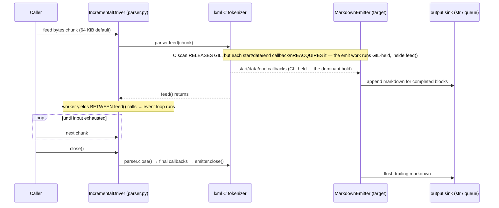
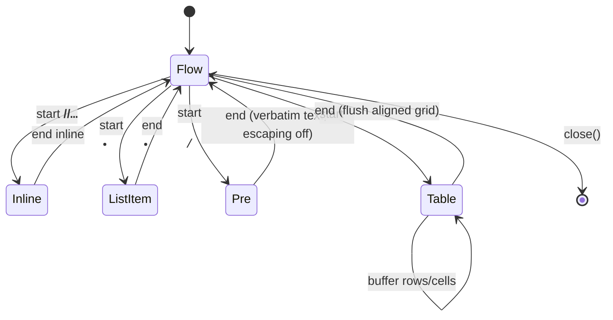
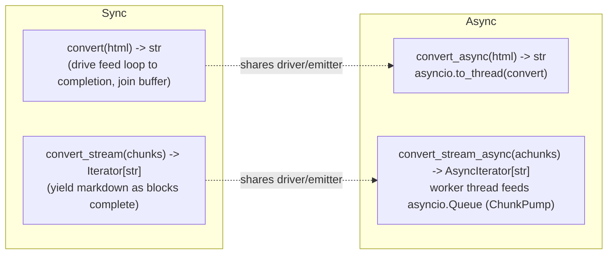

# marktide — Design Doc

> Fast, streaming HTML → Markdown conversion for Python, built on **lxml** (C, releases
> the GIL) instead of BeautifulSoup. Drop-in replacement for `markdownify` that parses
> large HTML incrementally — like a browser — and emits Markdown in chunks without
> stalling the asyncio event loop.

Status: **draft, pre-implementation.** Covers all three project phases. Companion docs:
`docs/test-plan.md` (black-box / comparison / load / manual QA test harness) and
`docs/research.md` (corpus + fixture sourcing, owned by coder-1-leaf, bead `zo-1fp.3`).

---

## 1. Summary

`markdownify` is BeautifulSoup-based. On large inputs it is slow, and — more importantly
for our workload — it is **pure Python**, so it holds the GIL for the entire conversion.
When a conversion runs inside an async request handler (even on a worker thread via
`run_in_executor`), a GIL-bound conversion stalls every other coroutine on the event
loop: health checks time out, SSE streams stutter, unrelated requests queue.

This project replaces it in three phases:

- **Phase 1 — Measure.** Build a benchmark harness that pits the incumbent
  (`markdownify`+BS4) against a Rust crate with Python bindings and against a naive
  `lxml` baseline, across input sizes from ~10 KB to ~100 MB. We measure not just speed
  (wall time, throughput, peak RSS) but the property we actually care about: **how badly
  each library stalls a live asyncio event loop**, on the main thread and on a worker
  thread. This phase *empirically decides whether phase 2 is even necessary.*

- **Phase 2 — Build (conditional).** If no existing library is both fast *and*
  event-loop-friendly, build `marktide`: a streaming converter driven by lxml's
  incremental **target parser**, structured so the longest contiguous GIL-hold is bounded
  by a chunk, not by the document. Public sync + async APIs, validated against a layered
  HTML→Markdown conformance corpus.

- **Phase 3 — Compare.** Re-run the phase-1 harness with `marktide` added as a fourth
  contender and a conformance/quality comparison against every prior implementation.
  Acceptance gates decide whether we ship.

### Key decisions & non-obvious properties

1. **The metric that matters is scheduling latency, not throughput.** A library can be
   fast and still be unusable in async code if it holds the GIL in one long burst. The
   phase-1 probe (§3.3) is the centerpiece, not an afterthought.

2. **Target parser, not DOM.** Phase 2 uses `lxml.etree.HTMLParser(target=…)` —
   SAX-like, push-based, **no element tree is ever built**. Memory is O(open-element
   depth), not O(document). This is what makes 100 MB inputs safe and what lets us
   interleave parse and emit so the GIL is released between chunks.

3. **The emitter is a deterministic pushdown transducer** over the SAX event stream (see
   §6.4 / §9 Alien Artifacts). Framing it this way gives us the central correctness
   property for free: **chunk-boundary invariance** — feeding the same bytes split at any
   set of offsets yields byte-identical output. This is the single most important
   invariant and is the backbone of the test harness.

4. **Drop-in option compatibility with `markdownify`.** The `Options` surface (§6.3)
   mirrors markdownify's keyword options where they have a sensible equivalent, so the
   incumbent can be swapped out at call sites with minimal churn.

5. **GIL release is structural, not incidental.** lxml's C tokenizer releases the GIL
   while scanning a fed buffer; our Python target callbacks reacquire it but run for a
   bounded, short time per chunk. The async path drives `feed()` on a worker thread so the
   event loop runs during the C-side scan and during the gaps between chunks.

---

## 2. Architecture

### 2.1 Component diagram


### 2.2 Phase-1 harness (separate from the library)


---

## 3. Phase 1 — Benchmark harness & GIL/async probe

The harness lives in `benchmarks/` and is a standalone tool, **not** part of the shipped
`marktide` package (it must run even before phase 2 exists). It is the instrument that
decides whether phase 2 is built.

### 3.1 Libraries under test

Each library is wrapped in an **adapter** that normalizes its native call shape behind one
uniform method: `adapter.convert(html_bytes: bytes) -> str`. The native shapes were
smoke-tested by coder-3-leaf (`docs/rust-candidate-smoke.md`); pinned versions come from
coder-1-leaf's research (`docs/research.md`). All candidates install via the
`[dependency-groups].benchmark` group so the shipped package depends only on `lxml`.

| Adapter | Package | Native call (normalized in adapter) | Engine | GIL under `to_thread` (preliminary spike, §3.1.2) | Notes |
|---|---|---|---|---|---|
| `markdownify` | `markdownify>=0.13` + `beautifulsoup4` | `markdownify(html)` | Pure Python (BS4) | **Held** (pure Python) | Incumbent / primary correctness oracle |
| `html_to_markdown` | `html-to-markdown==3.5.7` (Rust `html-to-markdown-rs`) | `html_to_markdown.convert(html).content` | Rust, abi3 wheel | **Held** — no `detach`; p95 ≈ **521 ms** | Primary Rust candidate. Pinned to 3.5.7 (released 2026-05-29), **not** the newest 3.6.13 — 3.6.13 shipped 2026-06-17 and is inside the 7-day supply-chain cooldown |
| `htmd_py` | `htmd-py==0.1.2` (Rust `htmd`) | `htmd.convert_html(html)` | Rust | **Held** — no `detach`; p95 ≈ **74 ms** | Turndown-inspired comparison |
| `html2text_rs` | `html2text_rs==0.2.5` (rust-html2text) | `html2text_rs.text_markdown(html)` | Rust | **Released** — `py.detach`; p95 ≈ **0.28 ms** | GIL-friendly but one-shot `str→str`, rejects `bytes`, and lower fidelity (drops bold). Secondary comparison |
| `lxml_naive` | `lxml>=5.0` | `lxml.html.fromstring` + recursive walk | C parse + Python tree walk | Released during C parse only; **held during the Python walk** | Establishes the "lxml without streaming" baseline that motivates phase 2 |

All adapters take/return the same `bytes → str` contract; the adapter is responsible for any
decode and for extracting the string from a wrapper type (e.g. `ConversionResult.content`).

`fast-marktide==0.2.0` is **excluded as a core engine**: coder-1-leaf found it is a Python
wrapper around BS4/tiktoken, not a native converter. It may be recorded as a footnote but
is not a contender. Per rubric pt 10, `docs/research.md` records for each candidate: license,
maintained-wheel availability (abi3/platform coverage), source pin, and whether it exposes
any streaming/options surface comparable to markdownify.

> Each adapter declares whether it supports being called on a worker thread safely. All
> listed do; the probe (§3.3) runs every adapter in both placements regardless.

#### 3.1.1 Apples-to-apples option normalization (reviewer-leaf P1 #3)

The candidates have **different defaults** (heading style, emphasis char, `<br>` handling,
table behavior), so benchmarking each at its *default* settings would confound semantics
with performance — a lib could look faster only because it does less. Before timing, each
adapter is configured **as close as its option surface allows to the exact option contract in
§6.3** (the faithful `markdownify==1.2.2` surface — setext h1/h2, `*` emphasis, two-space
`<br>`, fenced code, `escape_asterisks`/`escape_underscores` on, `escape_misc` off,
depth-chosen bullets, autolinks). The mapping is the canonical §6.3 `Options`, and each
adapter records in `benchmarks/harness/adapters/<name>.py` an `OPTION_MAP` naming, **per §6.3
field**, the chosen native kwarg (or that the dimension is unmappable).

Where a candidate **cannot** be normalized to the contract (e.g. `html2text_rs` emits
text-oriented output that drops bold; htmd-py lacks a setext option), the adapter records the
**residual divergence** in its `OPTION_MAP.residual` field, and the report presents that
library on **two explicitly separated axes** — performance/GIL *and* a semantic-distance
score vs the oracle — never as a single "is it better" number. A fast converter that
produces different Markdown is reported as fast *and* divergent, not conflated. This keeps
the phase-1 comparison meaningful (rubric pt 10).

#### 3.1.2 Preliminary spike findings (coder-3-leaf, `docs/rust-candidate-smoke.md`)

A throwaway probe (1 ms heartbeat, `~4.19 MiB` fixture, `asyncio.to_thread`) already
measured the candidates' GIL behavior. These numbers are **preliminary** — the phase-1
harness (§3.3) re-measures them properly across all sizes with the stage decomposition — but
they sharpen two design conclusions:

1. **No candidate exposes a Python streaming / incremental / reader API.** All three are
   one-shot `str → str` (and `html2text_rs` rejects `bytes` entirely). So even the
   GIL-friendly candidate must materialize the *entire* input string and output string in
   memory — O(input) RSS, no chunking — which a 100 MiB document makes painful regardless of
   speed. **This is the gap our streaming target-parser design (§4) fills, and no existing
   library closes it.**

   *Why streaming matters even though `html2text_rs` is already async-friendly:* releasing
   the GIL on a worker thread keeps the event loop responsive, but it does **not** give you
   the other two properties that a 100 MiB workload needs — (a) **bounded peak RSS**: a
   one-shot converter holds the full input *and* output in memory at once (O(input)), whereas
   the streaming path stays O(depth·chunk); and (b) **time-to-first-output**: a streaming
   converter emits Markdown for early blocks while the tail is still being parsed, so an SSE
   consumer sees bytes in milliseconds instead of after the whole document converts. Async-
   friendliness, bounded memory, and incremental output are three distinct properties; the
   existing libraries deliver at most one.

2. **The faithful, fast candidates hold the GIL; the GIL-friendly one is lossy.** Measured
   p95 heartbeat jitter under `to_thread`: `html-to-markdown` 3.5.7 ≈ **521 ms**, `htmd-py`
   ≈ **74 ms** (neither wraps the Rust call in `Python::detach` / `allow_threads`), versus
   `html2text_rs` ≈ **0.28 ms** (it *does* `py.detach`) — but html2text_rs is one-shot and
   drops formatting (bold → plain). Probe controls: idle ≈ 0.3 ms p95; a pure-Python loop on
   a worker thread ≈ 19 ms p95.

Net: the candidate with the best semantics (the primary Rust pick) is the *worst* async
citizen, and the best async citizen is semantically lossy and non-streaming. That pattern is
exactly the §3.5 gate's "no single library satisfies all four" outcome — so phase 2 looks
likely to be **build**, pending the full harness confirming it across sizes. We still run the
complete phase-1 measurement before committing; the gate decides on harness data, not this
spike.

### 3.2 Input corpus & sizes

Fixtures are generated by coder-1-leaf (`benchmarks/fixtures/`, gitignored, regen command
in `docs/research.md`) from real pages (Wikipedia / gov / RFC-style), concatenated in
deterministic chunks to hit target sizes:

Sizes per `docs/research.md` (real corpus: Wikipedia HTML / United States, RFC 9110, a
~36 MiB NASA Apollo page, repeated deterministically to exact byte targets):

| Tier | Target size | Purpose |
|---|---|---|
| `small` | ~100 KiB | Realistic single article; per-call overhead dominates |
| `medium` | ~5 MiB | Typical large document |
| `large` | ~50 MiB | Stress; where the Python tree-walk cost shows |
| `xlarge` | ~100 MiB | Memory + sustained GIL-hold stress; the case that motivates streaming |

Plus a small set of **synthetic pathological** fixtures generated by
`benchmarks/harness/synth.py` (committed, deterministic, tiny): deep nesting (10 k levels),
very wide tables (1 k columns), link-dense text, CDATA/comment-heavy, and declared-but-wrong
encodings. These exercise worst-case emitter paths and recovery, independent of the large
real fixtures.

**Fixture manifest & hash verification (reviewer-leaf P2 #2).** The large fixtures are
generated from *live* downloads, so they could drift or become accidentally malformed. The
**single committed manifest is `benchmarks/fixtures.lock.json`** (coder-1-leaf's existing file —
there is no separate `manifest.json`), regenerated by `scripts/regenerate_benchmark_fixtures.py`.
It already records per fixture `path`, `sha256`, `target_bytes`, `actual_bytes`, and a
`parse_guard` (lxml-parse-succeeded check), plus top-level `sources[]` (url + sha256 + bytes),
`generated_by`, and `no_raw_byte_truncation: true`. Implementation adds two fields to it: an
explicit `intentional: "safe-boundary" | "malformed-truncated"` flag and a `generator_version`,
so **safe-boundary** fixtures (valid HTML, closed at an element boundary) and **intentionally
malformed** truncated fixtures are *separate named cases* — a benchmark must never silently run
on accidentally-broken HTML. The nightly/on-demand bench jobs **verify each fixture's `sha256`
against `fixtures.lock.json` before timing** and abort with the exact regeneration command on
mismatch, so the output-hash fairness check (§3.4) and the perf baseline compare like against
like.

### 3.3 The async-yield / GIL-release probe — the decisive measurement

This is the core of phase 1. While a conversion runs, a background asyncio coroutine acts
as a **heartbeat**: it loops `await asyncio.sleep(INTERVAL)` (e.g. `INTERVAL = 5 ms`) and
records, for each tick, the *actual* elapsed wall time. With nothing competing, each tick
takes ≈ `INTERVAL`. If the converter holds the GIL, the loop cannot wake on time and the
**scheduling delay** (`actual − INTERVAL`) spikes. Scheduling delay is a direct,
quantitative proxy for "how much this conversion would hurt a live server."

Two placements, run for every (adapter × fixture):

```mermaid
sequenceDiagram
  participant Loop as Event loop (heartbeat coro)
  participant Conv as Conversion

  Note over Loop,Conv: Placement A — conversion ON the event-loop thread
  Conv->>Conv: convert() runs inline in a coroutine
  Loop--xLoop: heartbeat starved for the whole convert (worst case)

  Note over Loop,Conv: Placement B — conversion on a WORKER thread
  Loop->>Conv: await loop.run_in_executor(convert)
  alt engine releases GIL (lxml C scan / Rust allow_threads)
    Loop->>Loop: heartbeat keeps ticking ~on time
  else engine holds GIL (pure-Python markdownify)
    Loop--xLoop: heartbeat still starved despite worker thread
  end
```

- **Placement A (main thread):** conversion runs inline inside a coroutine. This is the
  worst case and the control — *any* CPU-bound work starves the loop here. Confirms the
  probe is calibrated (delay ≈ conversion time).
- **Placement B (worker thread):** conversion dispatched via `loop.run_in_executor`. Now
  the heartbeat stalls **only to the extent the engine holds the GIL**. This is the
  discriminating measurement: a Rust/lxml engine that releases the GIL keeps the heartbeat
  smooth; markdownify stalls it regardless of the thread.

**Probe metrics** (per run): max scheduling delay, p50/p95/p99 delay, total stall time
(Σ delay above a threshold), missed-beat count (ticks delayed > 2×INTERVAL), and the
longest single contiguous stall (the "max GIL-hold" estimate).

#### 3.3.1 Stage decomposition — do not overclaim parse-only (rubric pt 7, CRITICAL)

lxml releases the GIL **only during the C tokenizer scan**. The Python-side work that
follows — iterating the event stream and emitting Markdown — *reacquires* it. Benchmarking
"lxml parse" in isolation would prove the parser is async-friendly while saying nothing
about the whole library, which is the actual deliverable. The probe therefore measures the
`lxml_naive` and (in phase 3) `marktide` paths in **three separately instrumented stages**,
each run under the heartbeat:

| Stage | What runs | Expected GIL behavior |
|---|---|---|
| **S1 — parse only** | feed bytes to lxml, build/clear tree, discard output | GIL released during C scan → heartbeat smooth on worker thread |
| **S2 — parse + event iteration** | parse + walk every node (no Markdown emitted) | GIL reacquired for the Python walk → heartbeat degrades |
| **S3 — parse + iterate + emit** | full conversion to Markdown string | worst Python-side hold; the number that actually matters |

Reporting all three makes the GIL claim falsifiable and pinpoints *where* the hold lives —
for the streaming design (§4.2) the goal is that S3 on a worker thread stays close to S1
because emission is interleaved per chunk rather than done in one post-parse pass. The
one-shot Rust/markdownify adapters have no meaningful sub-stages (they are opaque
`bytes→str` calls) and are measured whole, but always in both placements.

**Baselines / controls** (validate the probe itself, and bound the claim), in
`benchmarks/harness/probe.py`:

- **Negative control — direct on loop:** every adapter also run inline on the event-loop
  thread (placement A); heartbeat delay must ≈ conversion time, proving the probe detects a
  stall at all.
- **Pure-Python CPU burner:** a busy-loop of known duration; in placement B it must show
  ≈ that delay, proving GIL-*hold* is detected (this is the markdownify-shaped control).
- **`time.sleep()` sleeper:** an equal-duration C sleep; in placement B it must show
  ~zero delay, proving GIL-*release* is detected (the ideal-engine control).
- **CPU + sleep mix:** alternating compute/sleep, to confirm the probe resolves *partial*
  GIL occupancy (the realistic middle ground), not just all-or-nothing.

Without these four, the probe numbers are unfalsifiable.

#### 3.3.2 Callback-density controls — a small byte chunk is not a small work chunk (reviewer-leaf P1 #4)

The whole async claim rests on "one `feed(chunk)` holds the GIL only briefly." That is **not
guaranteed by byte size**: a 64 KiB chunk of `<i></i><i></i>…` or a 1 k-cell table row can
fire *thousands* of Python `start`/`data`/`end` callbacks inside a single `feed()`, all with
the GIL held. So the probe must measure **Python-work density**, not just bytes, or it would
report a falsely-smooth heartbeat on benign fixtures and miss adversarial ones.

- **Callback-density fixtures** (added to `benchmarks/harness/synth.py`, committed,
  deterministic): thousands of empty tags in one chunk, deep nesting, a single row of
  thousands of tiny `<td>` cells, entity-storm text (`&amp;&lt;…` ×N), and link/image storms.
  These are run through the §3.3 probe in placement B at each swept `chunk_size`.
- **Per-feed metrics** reported alongside byte `chunk_size`: events per chunk, **max
  callbacks per `feed()`**, **max `feed()` wall time**, and the heartbeat delay attributable
  to that `feed()`. This is what makes "small chunk ⇒ short hold" falsifiable.
- **Acceptance bound:** max per-`feed()` wall time ≤ **2 ms** and worker-thread p99 heartbeat
  ≤ 2 ms (gate criterion 2) **on the callback-density fixtures**, not just the real corpus.
- **Fallback if the Python target parser cannot meet the bound** (specified now so it isn't
  invented under pressure): (a) **adaptive chunking** — shrink `chunk_size` dynamically when
  observed callbacks/byte exceed a threshold; (b) a **pull-parser loop** (`HTMLPullParser` +
  `read_events()`) with an explicit yield checkpoint every N events so the worker can release
  the GIL / the async pump can await mid-document; or (c) a **native (Cython/Rust) emitter**
  for the hot callback path. The phase-1/sweep data (zo-1fp.6) decides whether any fallback
  is needed.

### 3.4 Speed & memory meters

`benchmarks/harness/meters.py`:

- **Wall time:** `time.perf_counter()`. Report **cold** (first run, includes import/JIT/page
  faults) *and* **warm** (median of N runs after 1 discarded warmup, N configurable, default
  7) separately — cold matters for short-lived workers, warm for hot paths.
- **Throughput:** input bytes ÷ median wall time, reported MB/s.
- **Peak RSS:** sampled by a daemon thread polling `resource.getrusage(RUSAGE_SELF).ru_maxrss`
  (and `psutil` RSS for a continuous curve) around each run; reported as peak delta over
  baseline. The RSS *curve* matters for phase 2 (streaming must stay flat; whole-document
  parsers grow ~O(input)).
- **Output sanity:** length + a normalized hash of each adapter's output, so a degenerate
  (empty/garbage) result can't masquerade as "fast."

### 3.5 The phase-1 decision gate (concrete, versioned thresholds)

Phase 1 outputs `benchmarks/results/phase1.json` + a `report.md`. **Phase 2 is built iff**
no single existing library satisfies **all five** criteria below. These are **initial,
versioned gate values** (gate `v1`, set 2026-06-17) — concrete so different agents reach the
same verdict, and revisable only by editing this table + bumping the gate version, not by ad
hoc judgement. Tiers are §3.2 (`small`≈100 KiB … `xlarge`≈100 MiB).

| # | Criterion | Gate `v1` threshold | Measured by |
|---|---|---|---|
| 1 | **Throughput** | warm throughput ≥ **5×** markdownify on `medium`+ **and** ≥ **20 MB/s** absolute on `large`/`xlarge` | §3.4 meters |
| 2 | **Async-yield (worker thread, placement B, full convert S3)** | **< 2% of heartbeats delayed > 2 ms AND max delay < 15 ms** on every tier incl. `xlarge` and the callback-density fixtures (§3.3.2). Missed-beat% + max is the *primary* metric — percentiles under-weight rare long GIL-held windows (misc-leaf zo-1fp.7); p99 ≤ 2 ms is reported as a secondary signal | §3.3 probe |
| 3 | **Peak RSS** | one-shot path ≤ **3× input bytes**; a *streaming* candidate ≤ **256 MiB constant** on `xlarge` (i.e. O(chunk·depth), not O(input)) | §3.4 RSS curve |
| 4 | **Time-to-first-output (streaming only)** | first Markdown chunk ≤ **50 ms** and max inter-chunk gap ≤ **100 ms** on `large`/`xlarge`; one-shot libs structurally fail this (emit only after full convert) | §3.4 + §8 cadence meter |
| 5 | **Fidelity / options** | ≥ **99%** of conformance cases (§5) match the markdownify oracle post-normalization, with a compatible option surface (§6.3) and every divergence in `allowed_divergences.toml` | §5 conformance |

The 2 ms p99 bound in criterion 2 is set across the **full convert**, not parse-only —
misc-leaf's spike (`docs/gil-spike-findings.md`) showed the Python emit stage, not the C
parse, is the dominant GIL holder (on a 50 MiB doc emit ≈ 1 s > parse ≈ 0.5 s), so a
parse-only bound would overclaim (see §3.3.1, §4.2).

If a Rust candidate passes all five, we adopt it and **phase 2 is skipped** — the design
deliberately allows "don't build it" as the outcome. **Perf-regression tolerance** (phase 3
nightly): warm-throughput regression > 10% or worker-thread p99 regression > 0.5 ms vs the
stored `benchmarks/results/baseline.json` fails the job; the baseline is updated only by an
explicit `make bench-baseline` commit reviewed in a PR.

#### 3.5.1 Preliminary verdict from the spikes — phase 2 looks justified

The §3.1.2 spike plus a fidelity spot-check (coder-3-leaf,
`docs/rust-candidate-smoke.md:80-99`) already let us see how the gate is likely to resolve,
because the candidates fail it on *different* axes — no one library is close to passing all
five:

- `html-to-markdown` 3.5.7 / `htmd-py` — good fidelity, but **fail criterion 2** (hold the
  GIL, p95 ≈ 521 ms / 74 ms) and **criterion 3/4** (whole-string, no streaming).
- `html2text_rs` — the *only* async-friendly candidate (passes criterion 2), but **fails
  criterion 5 (fidelity)** and **3/4 (no streaming)**. The spot-check vs markdownify found
  material breakage across seven construct classes: `<pre><code>` blocks collapse to
  inline-ish backticks, tables render as box-drawing (`─┬─`) not pipe tables, `<hr>` is
  dropped, images lose URL+title (`` → `[alt]`), Markdown metacharacters are
  left unescaped (literal `*stars*` becomes emphasis), `<br>` hard breaks become plain
  newlines, and link titles are dropped.

So **no existing library provides all of {streaming, async-friendly, markdownify-fidelity}**
— each delivers at most one or two, which is exactly the "no single library satisfies all
five" condition. The preliminary read is therefore **build phase 2**, pending the full
phase-1 harness (all sizes, stage-decomposed + callback-density probe, normalized options)
ratifying the gate before any implementation bead opens. The gate decides on harness data,
not this spike.

**The phase-2 architecture itself is now empirically confirmed feasible** (misc-leaf
zo-1fp.7, `docs/chunked-pipeline-findings.md`, §4.2): a target-parser parse+emit pipeline on a
worker thread clears the async-yield gate with **~4× margin** (p99 0.49 ms, 0.1% missed beats,
and still 0.53 ms p99 even *un*-chunked) and collapses TTFO to ~0.1 ms on a 50 MiB doc — so
"build phase 2" is not a leap of faith, it is building a mechanism already prototyped to beat
the gate.

---

## 4. Phase 2 — Streaming lxml converter (conditional)

Built only if §3.5 says so. Browser-style: tokenize incrementally, emit Markdown as a
deterministic transducer over the event stream, never materialize a DOM.

### 4.1 Why the target parser

lxml offers three incremental options:

| API | Shape | Memory | Verdict |
|---|---|---|---|
| `lxml.html.fromstring` (whole doc) | Builds full tree | O(document) | The `lxml_naive` baseline; not streaming |
| `etree.HTMLPullParser` | `feed()` + `read_events()`, builds tree you must `.clear()` | O(document) unless aggressively cleared | Workable but you fight the tree |
| **`etree.HTMLParser(target=…)`** | SAX-like callbacks, **no tree built** | **O(open depth)** | **Chosen** |

We choose the **target parser**. The target object receives `start(tag, attrs)`,
`end(tag)`, `data(text)`, `comment(text)`, `close()` callbacks as the C tokenizer consumes
fed bytes. No element objects accumulate, so memory is bounded by nesting depth. The driver
constructs it as `etree.HTMLParser(target=…, recover=True, huge_tree=True)`: `recover=True`
handles malformed HTML the way a browser would, and **`huge_tree=True` is mandatory** —
without it libxml2 silently truncates large documents (misc-leaf spike, zo-1fp.4), a
correctness bug that an `xlarge` round-trip test guards against.

### 4.2 Incremental drive loop & GIL behavior



**GIL nuance (misc-leaf spike `docs/gil-spike-findings.md`, zo-1fp.4).** lxml's C scan
releases the GIL (confirmed: 316 heartbeats during a 0.5 s parse all at the ~0.33 ms idle
floor), **but the Python emit callbacks reacquire it** — and emit, not parse, is the
dominant cost (on a 50 MiB doc emit ≈ 1 s > parse ≈ 0.5 s, heartbeat pinned ~13 ms, the same
as a pure-Python CPU loop). So "run the parse on a worker thread" is **necessary but not
sufficient**; with the *target* parser the emit callbacks fire **inside `feed()`**, so
async-friendliness originally appeared to reduce to a single question: **does one chunk's worth
of callbacks hold the GIL for less than our 2 ms bound?** The later target-parser confirmation
below refined this: lxml yields between target callbacks even inside one large `feed()`, so
`chunk_size` is a cadence/memory/cancellation knob rather than the responsiveness knob.

**`chunk_size = 64 KiB`, empirically chosen** (coder-1-leaf sweep, zo-1fp.6,
`docs/chunk-size-sweep.md`). A worker-thread `feed()` sweep on a 50 MiB sample with a
counting target showed p99 heartbeat ≈ **0.4 ms** (≈ the 0.32 ms idle floor, far under the
2 ms gate) and ~67 MB/s throughput **flat from 4 KiB to 1 MiB** — there is no
throughput/jitter penalty across the range, so 64 KiB is picked for the plateau while keeping
cancellation/progress boundaries 16× tighter than 1 MiB and avoiding the feed-call density of
4–16 KiB. Because the target parser releases the GIL *between* callbacks (confirmed below), the
residual responsiveness risk is no longer a whole chunk's worth of callbacks but a **single
callback doing outsized work** (e.g. one enormous text node) — which is exactly what the
§3.3.2 callback-density fixtures stress. If one callback ever blows the per-feed budget, the
§3.3.2 fallbacks (adaptive chunking / pull-loop yield checkpoints / native emitter) apply.

**`huge_tree=True` is mandatory** (misc-leaf): libxml2 silently truncates large documents
without it. The driver sets it unconditionally; an `xlarge` round-trip regression test
asserts no truncation (test-plan §1).

**The chunked pipeline is empirically validated — phase 2's premise holds** (misc-leaf
zo-1fp.7, `docs/chunked-pipeline-findings.md`, incl. the "Target-parser confirmation" §,
findings 6–8). Driving parse+emit on a worker thread keeps the loop alive where a monolithic
parse-then-walk freezes it. The **chosen target parser** (`etree.HTMLParser(target=…)`, §4.1)
measured **strictly better than the pull-parser prototype on every axis** on a 50 MiB doc:
**p99 0.49 ms** (vs pull 2.5 ms), **0.1% missed beats**, **TTFO 0.1 ms** (vs 1.6 ms), **total
GIL stall 313 ms** (vs 1083 ms — 3.5× less, because it builds no DOM), and faster wall-clock
than the monolithic walk. The earlier pull-parser numbers (missed-beats 20% → 1%, p99
15.4 → 2.4 ms, TTFO 378 → 1.7 ms vs monolithic) stand as a **conservative historical bound** —
the chosen API beats them ~5× on p99.

**Responsiveness is intrinsic to the target parser, not a function of `chunk_size`.** Confirmed
empirically: feeding the **whole 50 MiB in a single un-chunked `feed()`** still yields **p99
0.53 ms / 0.1% missed** — if the GIL were held continuously the 5 ms involuntary-switch
interval alone would put p99 at 5–13 ms. Sub-ms p99 proves `feed()` **voluntarily releases the
GIL between callbacks**, at *element* granularity (finer than any byte chunk). So criterion 2
is met with **~4× margin even unchunked**, and the two knobs reclassify:

1. **`chunk_size` = the cadence / memory / cancellation knob — NOT the responsiveness knob.**
   Since responsiveness comes free from element-granular GIL release, `chunk_size` instead
   governs: TTFO & output cadence, peak memory / back-pressure, cancellation & progress
   granularity, and the close/flush shape. It can therefore be **relaxed (larger)** than a
   responsiveness budget would allow; the binding constraints are memory and cadence, not
   heartbeat. The sweep plateau (§ above) means 64 KiB stays a fine default, now justified by
   cadence/back-pressure/cancellation rather than by an SLO.
2. **A C/Cython emitter = the throughput knob.** Moving emit into C is the only lever that
   cuts *total* GIL work — misc-leaf's C-serializer variant cut total stall ~4× *and* beat
   monolithic on wall time. This is an **optimization (§10), not a requirement**: the
   pure-Python target emitter already clears the gate with large margin. We ship pure-Python
   first.

**Close-time flush caveat (hardening).** The prototype showed rare ~20 ms max spikes
(≈1/1000 beats) caused by accumulating the full ~30 MiB output and `join`-ing it at `close()`
(an end-of-parse allocation/GC spike). The real emitter must therefore **flush incrementally**
(which the §4.7 safe-flush barriers already mandate — output is committed per block, never
hoarded to `close()`). A **sustained-convert max-stall regression check** (test-plan §1/§5)
asserts the end-of-stream max stays under the gate, guarding against a regression that
reintroduces close-time hoarding.

### 4.3 Emitter state machine

The emitter is a state machine over the SAX stream. `EmitterState` (`state.py`,
`__slots__`) holds:

- **open-element stack** — list of frames `(tag, kind, bookkeeping)`; the transducer's
  pushdown stack.
- **list context** — stack of `(ordered, index, marker)` for nested `<ul>/<ol>`; controls
  indentation and bullet/number.
- **blockquote depth** — number of `> ` prefixes.
- **pre/code flag** — when set, text is emitted verbatim (no escaping, no whitespace
  collapsing).
- **table buffer** — a *bounded* per-table accumulator (rows → cells) needed because
  Markdown column alignment requires the header row before any row can be emitted; bounded
  by table width, not document size.
- **pending inline buffer** — small lookahead for whitespace collapsing and empty-block
  suppression.



Most rules are **local** (a tag maps to fixed prefix/suffix markdown). Only tables need
buffering, and that buffer is bounded. This locality is what makes chunk-invariance hold.

### 4.4 Module structure & import flow

```
src/marktide/
  __init__.py        # public API: convert, convert_async, convert_stream, convert_stream_async, Options
  convert.py         # orchestration; ties driver + emitter + options together
  parser.py          # IncrementalDriver — wraps etree.HTMLParser(target=…), feed loop, close/cleanup
  emitter.py         # MarkdownEmitter — the SAX target object; dispatches to rules
  state.py           # EmitterState (+ enums/frames), __slots__
  options.py         # Options dataclass + defaults + markdownify-compat mapping
  rules/
    __init__.py      # TAG_HANDLERS dispatch table {tag: handler}
    blocks.py        # p, h1-6, blockquote, hr, pre, ul/ol/li
    inline.py        # a, strong/em, code, img, br, span
    tables.py        # table/thead/tbody/tr/td/th (bounded buffer)
  _threaded.py       # ChunkPump — worker-thread driver feeding an asyncio.Queue
```

Import direction (no cycles): `__init__` → `convert` → {`parser`, `emitter`, `options`,
`_threaded`}; `emitter` → {`state`, `rules`, `options`}; `rules/*` → {`state`, `options`}
only. `parser` imports lxml and nothing from `emitter` except the target *type* via a
small protocol. `_threaded` imports `convert`/`parser`, never the reverse.

### 4.5 Sync ↔ async / streaming bridge



- `convert` / `convert_async`: one-shot. Async variant runs the whole sync drive on a
  worker thread; the event loop stays responsive because each `feed()` holds the GIL only for
  one chunk's callbacks (≤ 2 ms target, §4.2) and the worker yields between chunks — *not*
  because "lxml releases the GIL" alone (the emit callbacks reacquire it; §4.2).
- `convert_stream` / `convert_stream_async`: true streaming for huge inputs. The async
  generator is backed by `ChunkPump` (`_threaded.py`): each chunk's feed+emit runs on a
  worker thread and **the event loop is awaited between chunks**, which is the configuration
  misc-leaf (zo-1fp.7) measured as loop-alive — *not* one persistent worker that feeds
  continuously and never returns control. Safe-to-emit markdown (§4.7) is pushed onto a
  **bounded** `asyncio.Queue`; the async generator awaits it, so consumers see Markdown before
  the input is fully read (TTFO ~1.7 ms, §4.2) and the loop is never blocked beyond a single
  chunk's callbacks. The bounded queue provides back-pressure: a slow consumer stalls the
  worker (which stops reading input) instead of letting markdown accumulate unboundedly.

### 4.6 Resource safety

`IncrementalDriver` is a context manager. `close()` always runs (even on exception) to call
`parser.close()` and release the C parser. A conversion that raises mid-feed must not leak
the C parser or leave the worker thread alive — `ChunkPump` joins/cancels its thread in
`finally`. Tested by injecting exceptions mid-feed (see test-plan).

### 4.7 Streaming emission contract — safe-flush barriers (reviewer-leaf P1 #3)

Once `convert_stream` yields a chunk it **cannot be rewritten**, but markdownify-compatible
output is **not purely tag-local**: `process_text` / `process_tag` trim and collapse
whitespace based on *neighbouring* siblings, and tables are buffered until `</table>`. So the
emitter must never yield text whose correctness still depends on not-yet-seen events. We
define an explicit **safe-emission barrier** per construct: output is appended to a small
*pending region* and only **committed** (made eligible to yield) when its barrier is reached.

| Construct | Pending region held until… (barrier) | Why future events matter |
|---|---|---|
| Inline run / text | next block-level boundary, or enough following text to resolve trailing-whitespace collapse | markdownify trims/collapses whitespace at element boundaries using prev/next sibling |
| Link / image | the closing `</a>`/full `` attrs seen | href/title/alt all needed before emitting `[..](.. "..")` |
| Paragraph (`<p>`, `<hN>`) | element `end` | trailing-whitespace trim depends on close |
| List item (`<li>`) | its `end` **and** knowledge of whether a nested list follows | nested-list indentation/marker depends on children |
| Nested list | parent list item flushes after the whole sublist closes | indentation is relative to ancestors |
| Blockquote | the block inside closes (prefix `> ` applied per produced line) | line prefixing needs complete lines |
| `pre`/`code` | element `end` | fence vs indent + backtick-run length need full content |
| Table | `</table>` (bounded buffer) | column count/alignment need the header + widest row |
| `div`/`section`/`article` | transparent — flush children at their own barriers | wrapper contributes only block separation |
| Document | `close()` | flush all still-pending regions |

**Retained state between flushes** (in `EmitterState`): the open-element stack, the
trailing-whitespace/newline state of the last committed output (so the next region reproduces
markdownify's boundary trimming), and the current list/blockquote/pre context. Nothing else
needs to persist — committed output never depends on a region committed before it.

**Buffering bound.** `convert_stream` may buffer at most the **current innermost unclosed
block** (a paragraph, a list item's direct content, or a single table). Worst-case memory is
therefore O(largest single block), not O(document) — a pathological single 100 MiB `<p>` or
one giant table is the only way to inflate it, and that is the documented, tested worst case
(a fixture in test-plan §1). Normal documents stream with O(depth) memory.

**Test (test-plan §1 / component):** for selected fixtures, record the *sequence* of yielded
chunks and assert **no yielded prefix is ever mutated later** — i.e. the concatenation of
yielded chunks at every step is a prefix of the final whole-document output. This is the
streaming-specific complement to the chunk-invariance property (§9.1).

---

## 5. Phase 2 conformance — oracle & corpus

### 5.1 ONE primary oracle: markdownify-compatible (rubric pt 1)

The deliverable is a **drop-in replacement for `markdownify`**, so the **single primary
correctness oracle is markdownify itself** (pinned `markdownify==1.2.2`). "Correct" means:
for a given `Options`, `marktide.convert(html)` equals `markdownify(html, **equivalent_kwargs)`
after a defined normalization (§5.3), except for entries in an explicit divergence ledger.

This means `marktide`'s **defaults track markdownify's defaults**, not generic Markdown
fashion. From `markdownify.MarkdownConverter.DefaultOptions`
(`.venv/lib/python3.12/site-packages/markdownify/__init__.py:176`):

- `heading_style` = **underlined (setext) h1/h2**, not ATX — so `Options.heading_style`
  defaults to `"underlined"`.
- emphasis uses `*` / `**` (asterisk).
- `<br>` → **two trailing spaces** + newline (`newline_style="spaces"`), not backslash.
- markdownify's specific whitespace-collapse and boundary-trim behavior in
  `process_tag` (`__init__.py:234`) and `process_text` (`__init__.py:343`) is part of the
  contract — our emitter must reproduce it, and §7/§ test-plan carry golden cases for it
  specifically, not just per-tag happy paths.

Turndown / CommonMark / Pandoc are **secondary** and never mixed into the primary
assertions without a per-source normalization transform — markdownify and Turndown defaults
genuinely differ (heading style, emphasis char, br), so comparing raw expected outputs
across them would be meaningless.

### 5.2 Secondary behavioral layers (each behind a normalization transform)

| Layer | Source (pinned) | Role | Normalization |
|---|---|---|---|
| **Primary oracle** | `markdownify==1.2.2` (live, run in-process) | Drop-in compatibility — the assertion that gates phase 2 | §5.3 |
| Markdownify upstream tests | `matthewwithanm/python-markdownify` `tests/` @ pinned tag | Python-option coverage the live oracle doesn't exercise | identity (already markdownify-shaped) |
| Turndown corpus | `mixmark-io/turndown` `test/index.html` @ pinned commit (~147 cases) | Broad behavioral HTML→MD coverage | `turndown_to_markdownify` (§5.3.2) then `normalize_md` |
| Pandoc oracle | Pandoc `html` reader → `gfm`/`markdown_strict` writer @ pinned version | Independent stricter reference for hard cases | `pandoc_to_canonical` (§5.3.2); advisory, **non-gating** |
| Emitted-MD validity | CommonMark spec (`commonmark` / `markdown-it-py`) | **Not** an HTML→MD corpus — re-parses our *output* and asserts it renders to equivalent HTML (round-trip sanity) | n/a |

### 5.3 Validation method & fixture import (rubric pts 2–4, reviewer-leaf P1 #1)

**Mechanical, pinned import — no cherry-picking** (final layout owned by coder-1-leaf,
`zo-1fp.3`). The regenerator `scripts/regenerate_conformance_corpus.py` clones/downloads each
source at a pinned commit/tag/version, splits it into individual `(input.html, expected.md)`
cases, applies the per-source transform (below), and writes them under one **gitignored**
root `tests/conformance/fixtures/<source>/` (`markdownify/`, `turndown/`, `pandoc/`). Pins are
committed in `tests/conformance/sources.toml`; a committed `tests/conformance/fixtures.lock.json`
records each generated case's hash + provenance (source URL + commit) so CI verifies the
corpus before running. Regeneration is deterministic and idempotent. The turndown source uses
the `turndown-attendant` format (`<div class="case">` with nested `.input` / `pre.expected`),
parsed directly.

#### 5.3.1 The Markdown normalizer — exact, ordered, with a hard "never" list

Exact byte-equality across sources is unrealistic, so comparison runs both sides through a
**single normalizer** `normalize_md(text) -> str`. Because an over-eager normalizer would
*hide* real regressions, its operations are fixed and minimal, applied **in this order**:

1. Normalize line endings to `\n`; strip a trailing newline at EOF to exactly one.
2. Collapse **3+ consecutive blank lines** to exactly 2 (one blank line between blocks).
   *(Never collapses a single blank line to none — blank lines are semantic between list
   items / code / paragraphs.)*
3. Strip trailing spaces on a line **only when the line does not end in exactly two spaces**
   (preserve hard-break `  ` markers).
4. Within a contiguous unordered-list block, render the marker the comparison-canonical `-`
   **without changing indentation width** (indentation is semantic and is left byte-exact).
5. Normalize ordered-list numbering style to `N.` (drop `N)` variant) **without renumbering**.

It performs **NONE** of the following (the "never" list — each would mask a real bug):
changing indentation depth; adding/removing blank lines inside or around code blocks; altering
text inside `pre`/`code` fences; unescaping or re-escaping punctuation; rewriting link/image
**targets, titles, or alt text**; reordering or merging table columns; trimming inside inline
code. `normalize_md` is **idempotent** (`normalize_md(normalize_md(x)) == normalize_md(x)`).

#### 5.3.2 Secondary-source transforms (named, with non-goals)

Each secondary corpus is mapped to markdownify's dialect by a **named, pure** transform run on
its *expected* output **before** `normalize_md`, never folded silently into assertions:

- **`turndown_to_markdownify(md) -> str`** — rules: ATX `#`/`##` headings → setext
  underline; `_emphasis_` → `*emphasis*` and `__strong__` → `**strong**`; backslash hard
  breaks → two-space; reference-style links → inline `[t](u "title")`; turndown bullet `*` →
  the depth-appropriate markdownify marker. **Non-goals:** does not touch code-block fence
  style, does not reflow text, does not alter table rendering (cases where turndown and
  markdownify genuinely disagree on tables are marked divergent, not transformed).
- **`pandoc_to_canonical(md) -> str`** — advisory layer only (**non-gating**): strips Pandoc
  attribute spans (`{.cls}`), normalizes Pandoc fenced-div syntax away, maps setext/ATX to
  markdownify's setext. **Non-goal:** it does **not** attempt to make Pandoc's distinct
  list/table dialect identical — Pandoc is used via the render-both-to-HTML semantic check
  (§5.2), not byte comparison.

#### 5.3.3 `allowed_divergences.toml` schema

Every intentional difference from the oracle is one entry; an un-listed divergence fails the
gating test. Schema:

```toml
[[divergence]]
source = "turndown"            # corpus: markdownify | turndown | pandoc
case_id = "code-with-backtick" # stable id from the importer
diff_summary = "fenced code block vs markdownify indented block"
reason = "fenced is unambiguous for langs; documented option difference"
owner = "coder-2-leaf"
revisit = "when code_block_style is wired to markdownify's pre handling"  # expiry/condition
```

#### 5.3.4 Required edge-case coverage (golden cases, not happy paths)

Mapped to the markdownify methods reviewer-leaf flagged, so each has explicit golden cases:

| Behavior | markdownify ref | Fixture requirement |
|---|---|---|
| whitespace collapse / boundary trim | `process_tag` :234, `process_text` :343 | leading/trailing/inter-element whitespace runs |
| links / titles / autolinks | `convert_a` :438 | bare URL, titled link, autolink, link with parens in href |
| code-span backtick delimiter selection | `convert_code` :485 | code containing one and multiple backticks |
| image alt/src/title escaping | `convert_img` :582 | img with parens in `src`, special chars in `alt`/`title` |
| nested list indentation | `convert_li` :611 | nested `ul`/`ol`, mixed, deep |
| fenced pre/code | `convert_pre` :688 | `<pre><code>` block, language hint |
| table header inference / colspan | `convert_tr` :747 | header inference, colspan, ragged rows |

#### 5.3.5 Normalizer negative tests (prove it doesn't mask bugs)

The normalizer is itself tested (`tests/unit/test_normalization.py`) with **negative** cases
that must remain **different** after normalization: nested-list indentation changes, a blank
line added inside a code block, a swapped/renamed table column, a changed link target, a
changed link title, changed image alt text, and an escaped-vs-unescaped `*`/`_`. If
`normalize_md` ever collapses one of these to equal, the test fails — that is the guard that
keeps the gating oracle honest.

The CommonMark layer additionally parses our output and asserts it renders to the same HTML
structure, catching emitter bugs that yield ill-formed Markdown.

---

## 6. Public interfaces

### 6.1 Functions (`src/marktide/__init__.py`)

```python
def convert(html: str | bytes, *, options: Options | None = None) -> str: ...

async def convert_async(html: str | bytes, *, options: Options | None = None) -> str: ...

def convert_stream(
    chunks: Iterable[bytes], *, options: Options | None = None
) -> Iterator[str]: ...

async def convert_stream_async(
    chunks: AsyncIterable[bytes], *, options: Options | None = None
) -> AsyncIterator[str]: ...
```

- `html` accepts `str` or `bytes`. `bytes` is fed directly to lxml (preferred — lxml
  detects encoding from the meta/declaration; avoids a decode pass). `str` is encoded to
  UTF-8 first.
- The `*_stream` variants take/produce byte/markdown chunks for bounded-memory operation on
  arbitrarily large inputs.

### 6.2 Return type — resolved: plain `str`, no `ConversionResult` (reviewer-leaf P2 #3)

**Decision (was deferred, now fixed):** the public converters return a plain `str`, matching
markdownify's drop-in contract. We do **not** ship a `ConversionResult` / `convert_detailed`
API — there is no consumer for it in this project, and leaving it as an implementation-time
choice would add public-API uncertainty. Recovered-HTML warnings (from `recover=True`) are
surfaced via the standard `logging` module under the `marktide` logger, not a return value.
If a structured result is ever needed it will be its own reviewed design; it is out of scope
here.

### 6.3 `Options` (`src/marktide/options.py`)

`Options` is a **faithful typed representation of every `markdownify==1.2.2` option, with
identical names and defaults** (verified against `MarkdownConverter.DefaultOptions`,
`.venv/lib/python3.12/site-packages/markdownify/__init__.py:177-199`). This is what makes the
drop-in claim real and the §5.1 oracle exact — fixture expectations and the §3.1.1 benchmark
option mapping reference *this* contract, not a prose approximation.

```python
@dataclass(frozen=True, slots=True)
class Options:
    # --- markdownify==1.2.2 options: names + defaults are IDENTICAL ---
    autolinks: bool = True
    bullets: str = "*+-"                    # iterable of markers; nested ul picks by depth
    code_language: str = ""
    code_language_callback: Callable[[Element], str] | None = None
    convert: tuple[str, ...] | None = None  # allowlist of tags to convert; mutually
    strip: tuple[str, ...] | None = None    #   exclusive with `convert` (ValueError if both)
    default_title: bool = False
    escape_asterisks: bool = True
    escape_underscores: bool = True
    escape_misc: bool = False               # NOTE md default is False (not True)
    heading_style: Literal["underlined", "atx", "atx_closed"] = "underlined"  # md: setext h1/h2
    keep_inline_images_in: tuple[str, ...] = ()
    newline_style: Literal["spaces", "backslash"] = "spaces"  # md: <br> → two trailing spaces
    strip_document: Literal["strip", "lstrip", "rstrip"] | None = "strip"
    strip_pre: Literal["strip", "lstrip", "rstrip"] | None = "strip"
    strong_em_symbol: Literal["*", "_"] = "*"
    sub_symbol: str = ""
    sup_symbol: str = ""
    table_infer_header: bool = False
    wrap: bool = False
    wrap_width: int = 80
    # --- marktide-specific (no markdownify equivalent) ---
    chunk_size: int = 64 * 1024             # feed granularity; empirical default (§4.2, zo-1fp.6)
    default_encoding: str = "utf-8"
```

Notes on the differences reviewer-leaf flagged:
- `bullets="*+-"` (an iterable; the nested-`<ul>` marker is chosen by depth) — **not** a single
  `"-"`. This is required for nested-list parity (`convert_li`).
- `escape_misc=False` with `escape_asterisks=True` / `escape_underscores=True` are **three
  separate** markdownify knobs, reproduced exactly — collapsing them was wrong.
- `strip` and `convert` are the markdownify tag-filter semantics and are **mutually
  exclusive** (constructing `Options` with both non-`None` raises `ValueError`, matching
  `MarkdownConverter.__init__`). There is no `strip_tags`/`drop_tags` pair.
- `markdownify`'s `bs4_options` is BS4-specific and has **no marktide equivalent** (we drive
  lxml); it is intentionally absent.

**`markdownify_compat(**md_kwargs) -> Options`** is the migration contract: it accepts **every**
`markdownify==1.2.2` keyword and maps it onto the identical `Options` field. It raises
`ValueError` with an explicit, actionable message in two cases:
- `bs4_options` → `"bs4_options is not supported: marktide uses lxml, not BeautifulSoup; remove
  this kwarg"` (the parser backend differs, so the option is meaningless here);
- `strip` and `convert` both non-`None` → `"strip and convert are mutually exclusive (matching
  markdownify); pass at most one"`.
It is exhaustively tested in `tests/unit`: one acceptance case per `markdownify==1.2.2` option
asserting the mapped `Options` field, plus the two rejection cases asserting the exact
`ValueError` message.

### 6.4 Emitter target protocol (internal)

```python
class MarkdownEmitter:                 # the lxml target object
    def start(self, tag: str, attrs: dict[str, str]) -> None: ...
    def end(self, tag: str) -> None: ...
    def data(self, data: str) -> None: ...
    def comment(self, text: str) -> None: ...
    def close(self) -> str: ...        # flush + return (sync) / signal done (stream)
```

It is a **deterministic pushdown transducer**: input alphabet = SAX events, stack = open
elements, output = Markdown. Determinism + the stack-only state is exactly what guarantees
§9's chunk-invariance.

---

## 7. Testing (house-conventions: location + runner for every category)

This section covers unit / component / integration tests that ship with the code. The
*additional* black-box, comparison, load, smoke, and manual-QA harnesses live in
`docs/test-plan.md`.

### 7.1 Unit tests — `tests/unit/`
- **What:** per-tag rules (`rules/*`), `Options` defaults + `markdownify_compat` mapping,
  `EmitterState` transitions (list nesting, blockquote depth, pre/code escaping toggle),
  the table buffer's alignment computation, and `IncrementalDriver` cleanup/close.
- **Mocking:** none for emitter rules (feed real fragments). The async bridge is unit-tested
  with a fake driver to isolate `ChunkPump` queue/threading from lxml.
- **Coverage:** every application package carries a coverage gate.
- **Runner:** part of `make test`; `make unit` for unit+component alone; `make cov` for the
  coverage report.

### 7.2 Component tests — `tests/component/`
- **What:** full `convert()` over committed fixture documents (small/synthetic, not the
  100 MB ones); the four public entry points produce consistent output; async paths under a
  real event loop.
- **The headline property test (URP):** *chunk-boundary invariance.* A Hypothesis strategy
  splits fixture bytes at arbitrary offsets (including mid-tag and mid-multibyte-codepoint)
  and asserts `convert_stream(split) == convert(whole)` byte-for-byte. This is the core
  correctness guarantee.
- **Runner:** `make test` → `pytest tests/component` (CI, every PR).

### 7.3 Integration & conformance tests — `tests/integration/`, `tests/conformance/`
- **What:** conformance corpus comparison (§5) over `tests/conformance/fixtures/<source>/`
  with normalized semantic-equivalence + the `allowed_divergences.toml` ledger; CommonMark
  round-trip of emitted Markdown; an end-to-end async test that runs a conversion under a live
  heartbeat and **asserts** worker-thread full-convert p99 scheduling delay ≤ 2 ms (the probe,
  promoted from benchmark to assertion).
- **Runner:** `make conformance` → `pytest tests/conformance`; included in `make test`. The
  regenerator (`scripts/regenerate_conformance_corpus.py`) + a `fixtures.lock.json` hash
  verification are prerequisites when the pinned corpus is refreshed.

### 7.4 Benchmarks — `benchmarks/`
- **What:** the phase-1 and phase-3 harness (§3, §8). Not pytest; a CLI
  (`python -m benchmarks.harness.runner`) writing `benchmarks/results/*.json`.
- **Runner:** `make bench` (on-demand) + a nightly perf-tracking job that fails on
  regression beyond a tolerance.

**Implemented Makefile targets** (the source of truth is `make help`): CI runs exactly
`make lint` (ruff + ty) and `make test` (the full suite — unit, component, conformance,
property, e2e). `make bench` runs the benchmark harness; `make verify-fidelity` reproduces the
conformance headline. Subset targets (`make unit`/`conformance`/`property`/`e2e`) run one slice.

---

## 8. Phase 3 — Comparison methodology

Phase 3 reuses the phase-1 harness verbatim, adding an `marktide` adapter (and its streaming
entry points), and adds a quality dimension:

1. **Performance & GIL re-run.** Same fixtures, meters, and probe as §3, now five adapters.
   Primary plots: throughput vs size; **worker-thread p99 scheduling delay vs size** (the
   headline — marktide should stay flat where markdownify blows up); peak-RSS curve vs size
   (marktide streaming should stay flat where DOM parsers grow linearly); and
   **time-to-first-output + inter-chunk cadence vs size** (marktide streaming emits early;
   one-shot libs structurally cannot).
2. **Conformance/quality comparison.** Run every adapter over the §5 corpus; score each
   against the normalized oracle. Report a per-adapter compatibility matrix and a diff
   gallery for the worst cases.
3. **Acceptance gates — the concrete §3.5 `v1` thresholds applied to marktide** (not a fresh
   placeholder set): throughput (crit 1), worker-thread full-convert p99 ≤ 2 ms (crit 2),
   streaming peak RSS ≤ 256 MiB on `xlarge` ≈ O(chunk·depth) (crit 3), **TTFO ≤ 50 ms / max
   inter-chunk gap ≤ 100 ms on `large`/`xlarge`** (crit 4), and ≥ 99% conformance with every
   divergence enumerated (crit 5). **marktide ships iff it passes all five**; if it fails
   fidelity but a Rust candidate also fails on memory/TTFO, the recommendation is explicit
   rather than a judgement call. Phase 2 was justified precisely because no candidate met the
   combined quality + memory + TTFO bar even though one (html2text_rs) is loop-friendly.
4. **Output:** `benchmarks/results/phase3.json` + `docs/phase3-report.md` with the
   recommendation (ship marktide / adopt Rust candidate / stay on markdownify).

---

## 9. Unreasonably Robust Programming (URP)

Concrete commitments, each with mechanism + test home:

1. **Chunk-boundary invariance (property test).** *Property:* for any partition of input
   bytes into chunks, `convert_stream(partition)` is byte-identical to `convert(whole)`.
   *Generator:* Hypothesis strategy emitting a fixture + a random sorted set of split
   offsets, **explicitly biased to land inside each adversarial construct reviewer-leaf
   called out**: inside a start tag, inside an attribute value, inside a character/entity
   reference (`&amp;`), inside a comment (`<!-- … -->`), inside a CDATA/script block, in the
   middle of a whitespace run, inside a `<pre>`/`<code>` block, between a table row's cells,
   and at nested-list `<li>` boundaries — plus mid-UTF-8-sequence. Every committed fixture
   (§3.2, §5) is also run at a sweep of fixed chunk sizes (1, 7, 64, 4096, … bytes) as golden
   cases, not only randomized splits. *Home:* `tests/component/test_chunk_invariance.py`,
   `make test`. *Why it holds:* the emitter is a deterministic transducer whose only state is
   the open-element stack; `feed()` is a homomorphism over byte concatenation, so output is
   independent of where the stream is cut.

2. **Differential fuzzing vs markdownify.** Generate random valid-ish HTML (Hypothesis DOM
   strategy → serialized HTML); assert normalized-semantic equivalence to markdownify, or a
   logged entry in `allowed_divergences`. *Home:* `tests/integration/test_differential.py`,
   nightly. Shrinks failures to minimal HTML.

3. **Adversarial/malformed corpus.** Unclosed tags, 10 k-deep nesting, lying encoding
   declarations, CDATA/comment storms, NUL bytes, truncation mid-tag. *Invariants:* never
   crash, always terminate, bounded memory, parser resources freed. lxml `recover=True`
   plus a depth guard. *Home:* `tests/component/test_malformed.py` + `benchmarks/harness/synth.py`
   fixtures, `make test`.

4. **Bounded-memory assertion.** Convert `xlarge` (100 MB) via `convert_stream` while
   sampling RSS; assert peak < K·(chunk_size·max_depth), i.e. independent of input size.
   *Home:* `tests/integration/test_memory_bound.py`, nightly (needs the large fixture).

5. **Crash safety / no leaks.** Inject exceptions from the emitter mid-feed; assert the C
   parser is closed and `ChunkPump`'s worker thread is joined (no thread/fd leak). *Home:*
   `tests/unit/test_driver_cleanup.py` + `tests/component/test_pump_cleanup.py`, `make test`.

6. **Deterministic output.** Same input → byte-identical output across runs and platforms
   (no dict-ordering or hash-seed dependence). *Home:* `tests/component/test_determinism.py`,
   `make test`.

7. **Calibrated probe (the measurement is itself tested).** The GIL probe ships with
   GIL-holding and GIL-releasing controls (§3.3) so its numbers are falsifiable. *Home:*
   `benchmarks/harness/test_probe_calibration.py`, `make bench` + a CI smoke run on tiny
   inputs.

---

## 10. Extreme Optimization

Concrete, measured (every claim has a harness number behind it):

1. **Bytes in, no decode pass.** Feed `bytes` straight to lxml; let the C layer handle
   encoding. Avoids a full-document Python `decode()`. Measured by the `bytes` vs `str`
   path in the harness.
2. **Single allocation out.** Emitter appends to a `list[str]` and `"".join`s once (sync),
   or yields chunks (stream) — no repeated string concatenation.
3. **Dispatch table, no if/elif.** `rules.TAG_HANDLERS: dict[str, Handler]`; O(1) tag
   dispatch in the hot path. `EmitterState`/`Options` use `__slots__`/`slots=True` to cut
   per-instance attribute overhead.
4. **Chunk-size sweep (cadence / memory knob).** Swept 4 KiB…1 MB; throughput/jitter plateau →
   64 KiB default (zo-1fp.6, §4.2). Responsiveness is intrinsic (the target parser releases the
   GIL between callbacks, §4.2), so `chunk_size` tunes TTFO cadence, peak memory / back-pressure,
   and cancellation granularity — not the heartbeat SLO — and does **not** cut total GIL work.
5. **C/Cython emitter (the throughput knob — distinct from #4).** misc-leaf (zo-1fp.7) showed
   moving emit into C is the *only* lever that cuts **total** GIL work: a C-serializer emit
   variant cut total stall ~4× **and** beat the monolithic walk on wall time. This is a real,
   measured optimization — **but not a requirement**: the pure-Python emitter at 64 KiB
   already meets the async-yield gate (1% missed beats, 11 ms max). So the plan ships
   pure-Python first; the C emitter is the documented next EO step, justified by the harness
   if/when throughput (not responsiveness) is the binding constraint. We do not pre-optimize
   past the evidence, but here the evidence already exists and quantifies the payoff.

---

## 11. Alien Artifacts

### 11.1 The converter is a Deterministic Streaming Tree Transducer (DSTT)

The emitter is not merely "a stack machine that happens to stream" — it is precisely a
**Deterministic Streaming Tree Transducer**, the nested-word/tree generalization (Alur &
D'Antoni, *Streaming Tree Transducers*, 2012) of the **Deterministic Streaming String
Transducer** (Alur & Černý, 2010). DSSTs extend finite-state transducers with a finite
set of **string-valued registers** updated by **copyless** (linear) assignments per input
symbol; this is exactly the class of MSO-definable (regular) string transformations, and
it buys single-pass, linear-time, bounded-memory evaluation. The tree variant lifts this
to **nested words**, which is what our input is.

**Why the input is a nested word.** lxml's target-parser callbacks form a *visibly
pushdown alphabet*: `start(tag)` is a *call*, `end(tag)` is a *return*, and `data`/
`comment` are *internal* symbols. The call/return structure is given by the tag nesting,
so the SAX stream is a well-matched nested word — the native input of a streaming tree
transducer.

**The registers (EmitterState → DSTT registers).** Output is never written to a global
tape; it accumulates in registers that are combined by copyless updates:

| DSTT register | Implementation (`state.py` / `emitter.py`) | Update discipline |
|---|---|---|
| Pushdown stack of string registers | `Frame.content` for each open element (one register per stack frame) | On `end`, the frame's register is concatenated — with a fixed prefix/suffix or a transform — into its nearest *buffering* ancestor's register **exactly once**, then discarded. Copyless: no register is read into two places. |
| Streamed-root register | `root` (drained incrementally) | Transparent containers stream children straight to it; it is released by `drain()`, so it is not retained. |
| Boundary-collapse carry | `_carry` (last child's trailing newlines) | O(1) scalar; carries the child-boundary newline-collapse state across drains so the fold is split-independent. |
| Document-trailing hold | `_tail` (held trailing newlines) | O(1) scalar; withholds separator newlines that the document-end strip may remove. |
| Text-coalescing register | `_text_buf` (one logical text node) | Bounded by one text node; flushed on the next non-data event so normalization is feed-independent. |
| Sibling-whitespace registers | `Frame.pending_ws` / `last_child_block` / `seen_child` | O(1) per frame; a one-event lookahead implementing markdownify's block-boundary trim without breaking single-pass evaluation. |
| List/blockquote context | `list_stack`, blockquote depth, `pre_depth` | O(depth) finite context; the pushdown control state. |
| **Bounded register-array (table reservoir)** | `table_stack` of `TableBuffer` | See §11.2. |

**Structural theorems** (these are consequences of the DSTT structure, not aspirations):

- **Linear time, single pass.** Each nested-word symbol triggers O(1) amortized register
  operations (append to the current register; on `end`, one concatenation into the parent;
  the boundary-collapse fold is incremental via `_carry`). Total work is
  **O(|input| + |output|)** with a single left-to-right pass — no document re-scan.
- **Bounded memory.** Resident register memory is **O(open-depth + largest-open-block +
  table-reservoir)** — *not* O(|input|). The pushdown holds one register per *currently
  open* element; completed output is drained and released. For documents whose individual
  blocks and tables are bounded, this is **O(depth + table-width)**; the only way to
  inflate it is a single pathological open block (a 100 MiB `<p>`) or one giant table,
  which is the documented worst case (§4.7). This is the corrected bound: O(depth +
  buffered-content), not pure O(depth).
- **Chunk-invariance** (§9.1, *empirically confirmed* — 1107/1107 conformance cases give
  byte-identical `convert == convert_stream` under adversarial splits). Determinism over
  the nested word gives output independent of input chunking **provided the nested word
  itself is chunk-independent**. lxml violates this for special elements (it splits one
  text node across `data()` callbacks at feed boundaries); the **text-coalescing register**
  restores it by reconstructing the logical text node before any feed-dependent
  observation. With coalescing, `feed()` is a monoid homomorphism over byte sequences and
  chunk-invariance holds by construction.

### 11.2 Bounded two-pass table alignment within a register-array

Markdown table column widths and alignment need the header row (and the widest cell)
before *any* row can be emitted, so a `<table>` cannot stream cell-by-cell. We model the
table as a **bounded register array** — the DSTT extension where a register holds a
bounded vector of strings — sized by the table's own dimensions, never by document size
(`TableBuffer`: rows → cells). The grid is flushed as one register concatenation at
`</table>`. This is a localized two-pass (buffer rows, then align) nested inside the
otherwise single-pass stream, and it preserves the global memory bound: O(depth +
table-reservoir), with the reservoir bounded by the current table, independent of
surrounding document length.

### 11.3 Runtime invariant — the memory bound is measured, not assumed

The bounded-memory theorem is enforced by a runtime invariant test
(`tests/unit/marktide/test_memory_invariant.py`, `make test`): it streams documents of
increasing size and asserts the **live register footprint** (open-frame buffers + the O(1)
scalar registers + table reservoir, excluding drained output) does **not** scale with
input length — 4× the input must not 4× the footprint — and that depth, a single giant
block, and the table reservoir each behave as the theorems predict. This turns the
DSTT structural claim into a continuously-checked property rather than a comment.

---

## 12. Open questions (for reviewer / pre-implementation)

Resolved in this revision (review round 1):

- ~~Numeric thresholds~~ → concrete gate `v1` set in §3.5 / §8.3.
- ~~Return type~~ → resolved to plain `str`, no `ConversionResult` (§6.2).
- ~~Option-compatibility scope~~ → full faithful `markdownify==1.2.2` parity (§6.3).

Still open (do not block implementation; pick during build with a follow-up note):

1. Whether `convert_stream_async`'s `ChunkPump` uses a shared thread pool or a dedicated
   thread per conversion — both satisfy the bounded-queue back-pressure contract (§4.5); the
   load tests (test-plan §5) will decide based on concurrency behavior.
2. Whether any §3.3.2 fallback (adaptive chunking / pull-loop / native emitter) is actually
   needed — deferred to the phase-1 callback-density results; 64 KiB fixed feed is the
   starting point (§4.2).

---

## 13. Review disposition

### Round 1 — `reviewer-leaf`, reviewed `445bae8` (`docs/design-review.md`)

8 findings: 0 P0, 5 P1, 3 P2, 0 P3. All incorporated.

| # | Sev | Finding | Disposition | Where |
|---|---|---|---|---|
| 1 | P1 | Normalization / secondary-corpus transforms too vague | **Fixed** — ordered `normalize_md` spec + hard "never" list, named `turndown_to_markdownify` / `pandoc_to_canonical` with non-goals, `allowed_divergences.toml` schema, normalizer negative tests | §5.3.1–5.3.5 |
| 2 | P1 | `Options` doesn't track `markdownify==1.2.2` defaults | **Fixed** — faithful typed surface, exact names/defaults (`bullets="*+-"`, `escape_misc=False` + `escape_asterisks/underscores`, `strip`/`convert` mutual exclusion, all missing knobs), `markdownify_compat` accept/reject contract | §6.3, §3.1.1 |
| 3 | P1 | Streaming emission safe-flush barriers undefined | **Fixed** — per-construct barrier table, retained state, buffering bound (O(largest block)), prefix-immutability test | §4.7 |
| 4 | P1 | GIL bound can be exceeded by callback-heavy chunks | **Fixed** — callback-density fixtures + per-`feed()` metrics + 2 ms bound + named fallbacks; reinforced by zo-1fp.6 sweep | §3.3.2, §4.2 |
| 5 | P1 | Acceptance thresholds are placeholders | **Fixed** — concrete versioned gate `v1` (throughput/p99/RSS/TTFO/fidelity + regression tolerance) | §3.5, §8.3 |
| 6 | P2 | No time-to-first-output gate | **Fixed** — TTFO + cadence added as gate criterion 4 and a phase-3 plot | §3.5 (crit 4), §8 |
| 7 | P2 | Fixture reproducibility via mutable downloads | **Fixed** — single `fixtures.lock.json` (hashes/provenance/intentional-flag), safe-boundary vs malformed split, pre-bench hash verification | §3.2 |
| 8 | P2 | `ConversionResult` unresolved scope | **Fixed** — removed; `convert` returns `str`, warnings via logging | §6.2 |

Also folded in (not review findings, from parallel spikes): misc-leaf GIL spike (zo-1fp.4 —
emit is the dominant GIL holder, `huge_tree=True` mandatory), coder-3-leaf fidelity spot-check
(go/no-go in §3.5.1), coder-1-leaf chunk-size sweep (zo-1fp.6 — 64 KiB default) and final
conformance corpus paths.

### Round 2 — `reviewer-leaf`, reviewed `2e7856c` (`docs/design-review.md` @ `3111bd0`)

**APPROVED FOR IMPLEMENTATION** — all 5 P1 + 3 P2 resolved, no blockers. Two minor non-blocking
notes + one post-approval correctness refinement folded in (reviewer confirmed; approval stands):

| Item | Disposition | Where |
|---|---|---|
| (note) Fixture manifest naming `manifest.json` vs `fixtures.lock.json` | **Reconciled** — single existing `benchmarks/fixtures.lock.json` via `scripts/regenerate_benchmark_fixtures.py`; adds `intentional` + `generator_version` fields | §3.2 |
| (note) `markdownify_compat` `bs4_options` rejection | **Fixed** — explicit `ValueError` messages (bs4_options + strip/convert) with dedicated rejection tests | §6.3 |
| Target-parser confirmation (misc-leaf zo-1fp.7 `95a6e89`) | **Corrected** — `chunk_size` reclassified as the cadence/memory/cancellation knob (responsiveness is **intrinsic**: target parser releases the GIL between callbacks; whole 50 MiB unchunked still p99 0.53 ms / 0.1% missed; gate met ~4× over even unchunked). Real target-parser numbers cited (p99 0.49 ms, TTFO 0.1 ms, 3.5× less GIL stall); pull-parser numbers kept as conservative bound. Close-time flush caveat + sustained-max regression check added | §4.2, §3.5.1, §10, test-plan §1 |
