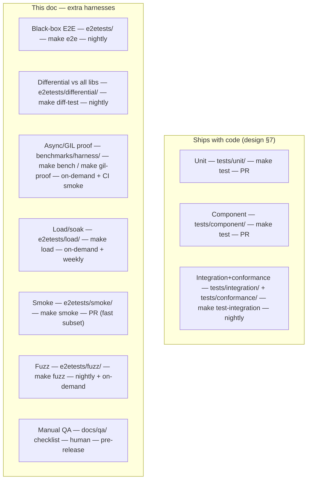

# html2md — Test Plan

> Companion to `docs/design.md`. The design doc covers the unit / component / integration
> tests that **ship with the code** (design §7). This document covers the *additional* test
> harnesses that give us confidence beyond those: black-box end-to-end, differential
> comparison against every prior implementation, the async/GIL proof harness, load &
> soak testing, smoke tests, fuzzing, and human-judgement manual QA.

Status: **draft, pre-implementation.** Every harness below specifies, per house convention:
**(1)** exact repo path, **(2)** runner / make target, **(3)** CI / nightly / on-demand
placement, **(4)** artifact / output format.

---

## 0. Test taxonomy & where each lives

| Suite | Path | Make target | Cadence | Artifact |
|---|---|---|---|---|
| Black-box E2E | `e2etests/` | `make e2e` | nightly | JUnit XML + `e2etests/results/e2e.json` |
| Differential | `e2etests/differential/` | `make diff-test` | nightly | `differential_report.html` (diff gallery) + JSON |
| Async/GIL proof | `benchmarks/harness/` | `make gil-proof` | on-demand + CI smoke (tiny) | `benchmarks/results/gil.json` + plots |
| Performance | `benchmarks/harness/` | `make bench` | on-demand + nightly perf-track | `benchmarks/results/phase{1,3}.json` + plots |
| Load / soak | `e2etests/load/` | `make load` | on-demand + weekly | `e2etests/results/load.json` + RSS curves |
| Smoke | `e2etests/smoke/` | `make smoke` | **PR** | console + JUnit |
| Fuzz | `e2etests/fuzz/` | `make fuzz` | nightly + on-demand | Hypothesis DB + minimized repros |
| Manual QA | `docs/qa/checklist.md` | human | **pre-release gate** | signed checklist in PR |

Per house convention, heavy cross-cutting suites live in a top-level `e2etests/` tree, kept
separate from the application package's lightweight unit tests.

---

## 1. Black-box end-to-end tests — `e2etests/`

Exercise the public API exactly as a consumer would, treating `html2md` as opaque. No
internal imports beyond the public surface (`convert`, `convert_async`, `convert_stream`,
`convert_stream_async`, `Options`).

- **Core flows, all four entry points:** the same set of representative documents must
  convert correctly via (a) `convert`, (b) `convert_async`, (c) `convert_stream`, (d)
  `convert_stream_async`, and all four must agree byte-for-byte. *Path:*
  `e2etests/test_public_api.py`.
- **Real-page corpus:** a small committed set of real HTML pages (article, docs page, table-
  heavy page, wiki page) → assert structural invariants (heading count, link count, list
  nesting, table shape) survive conversion. *Path:* `e2etests/test_real_pages.py`,
  fixtures in `e2etests/fixtures/pages/` (small, committed — distinct from the gitignored
  100 MiB benchmark fixtures).
- **Encoding & malformed:** non-UTF-8 declared encodings, lying declarations, BOMs,
  unclosed tags, truncated input — must not crash, must produce sensible Markdown. *Path:*
  `e2etests/test_robustness.py`.
- **Runner:** `make e2e` → `pytest e2etests` (excluding `load/`, `fuzz/`).
- **Cadence:** nightly + on-demand. A fast subset is tagged `@smoke` (see §6) for PRs.
- **Artifact:** JUnit XML + `e2etests/results/e2e.json` (per-case pass/fail + invariant
  counts).

---

## 2. Differential / comparison testing vs all prior implementations — `e2etests/differential/`

This is the **porting-comparison harness** (design phase 3, rubric pts 1–4). Because we are
replacing markdownify, the strongest correctness evidence is: *for the same input, does
html2md agree with the agreed oracle, and how does it compare to every other candidate?*

### 2.1 Oracle comparison (gating)

- **Oracle:** live `markdownify==1.2.2` (design §5.1), the drop-in target.
- **Method:** over the conformance corpus (`tests/conformance/*_cases/`) **and** the real-page
  corpus, run html2md and markdownify, normalize both (design §5.3 normalization), assert
  semantic equivalence. Every divergence must be listed in
  `e2etests/differential/allowed_divergences.toml` with a reason, or the test fails.
- **Path:** `e2etests/differential/test_vs_markdownify.py`.

### 2.2 Cross-library comparison matrix (reporting, non-gating)

- Run **all** adapters (markdownify, html_to_markdown 3.5.7, htmd-py, html2text_rs,
  lxml_naive, html2md) over the corpus; for each case render every output → HTML via a
  CommonMark parser → normalized DOM, and score pairwise semantic agreement.
- **Output:** a `differential_report.html` **diff gallery** — per case, side-by-side rendered
  Markdown + a structural diff, sorted worst-divergence-first. This is the human-reviewable
  artifact for the phase-3 recommendation.
- **Path:** `e2etests/differential/matrix.py`.

### 2.3 Normalization correctness

- The normalization function itself is unit-tested (idempotent, doesn't mask real
  differences) in `tests/unit/test_normalization.py` (`make test`) — a normalizer that's too
  aggressive would hide bugs, so it is tested independently.

- **Runner:** `make diff-test` → `pytest e2etests/differential` (gating part) + `python -m
  e2etests.differential.matrix` (report). **Cadence:** nightly. **Artifact:**
  `differential_report.html` + `e2etests/results/differential.json`.

---

## 3. Async / GIL proof harness — `benchmarks/harness/` (the decisive evidence)

This is the harness behind design §3.3 / §3.3.1. It is called out separately here because it
is the project's central claim ("doesn't stall the event loop") and rubric pt 7 demands it be
proven, not asserted.

### 3.1 What it runs

For each (adapter × fixture size × placement), with a background heartbeat coroutine
(`await asyncio.sleep(5ms)` loop) recording per-tick scheduling delay:

- **Placements:** A = inline on the event-loop thread (negative control), B = via
  `asyncio.to_thread` / `run_in_executor`.
- **Stage decomposition** for the lxml/html2md paths: S1 parse-only, S2 parse+iterate, S3
  full convert (design §3.3.1) — so we never overclaim parse-only GIL release.
- **Controls/baselines:** pure-Python CPU burner (must stall in B), `time.sleep` sleeper
  (must not stall in B), CPU+sleep mix (partial occupancy).

### 3.2 What it asserts / reports

- **Reported:** p50/p95/p99/max heartbeat delay, total stall, missed beats, longest
  contiguous stall, plus throughput (so a "smooth but trivially slow" engine is visible).
- **CI smoke assertion:** on tiny inputs, a regression test asserts the *ordering* holds —
  markdownify placement B stalls ≥ N× more than the lxml/html2md placement-B S1 — and that
  the controls behave (CPU burner stalls, sleeper doesn't). This catches a probe that has
  silently broken. *Path:* `benchmarks/harness/test_gil_smoke.py`, runs in **PR CI** on
  tiny fixtures only (fast).
- **Calibration test:** `benchmarks/harness/test_probe_calibration.py` asserts the four
  controls produce their expected signatures (design §3.3). **PR CI.**

- **Runner:** `make gil-proof` → `python -m benchmarks.harness.runner --probe` (full, all
  sizes, on-demand) and `pytest benchmarks/harness/test_gil_smoke.py` (CI smoke).
- **Artifact:** `benchmarks/results/gil.json` + heartbeat-delay-vs-time plots and the
  headline **worker-thread p99 delay vs input size** chart.

---

## 4. Performance harness — `benchmarks/harness/` (phase 1 & 3)

Design §3.4 / §8. Listed here for completeness of the test inventory.

- **Method:** cold + warm runs (design §3.4), N repetitions, fixed input bytes, peak RSS via
  sampling thread, output byte-count + hash to defeat dead-code-elimination-style fake
  benchmarks (rubric pt 8), sizes through ~100 MiB, **process isolation per adapter** (each
  adapter benchmarked in its own subprocess so import-time/global state and allocator
  warmth don't leak across libraries — per research.md "same runner process isolation").
- **Path:** `benchmarks/harness/runner.py`, adapters in `benchmarks/harness/adapters/`.
- **Runner:** `make bench`. **Cadence:** on-demand + nightly perf-track job that fails on
  regression beyond tolerance vs a stored baseline (`benchmarks/results/baseline.json`).
- **Artifact:** `benchmarks/results/phase{1,3}.json` + throughput / RSS-curve / p99-delay
  plots.

---

## 5. Load & soak testing — `e2etests/load/`

Validates behavior under sustained and concurrent load — the real production shape (many
conversions on a shared event loop).

- **Concurrency / responsiveness:** spawn K concurrent `convert_async` calls on one event
  loop while the heartbeat runs; assert aggregate throughput scales and **p99 heartbeat
  delay stays under bound** even with K conversions in flight (this is the property that
  actually protects the server). *Path:* `e2etests/load/test_concurrent_async.py`.
- **Soak / memory stability:** run thousands of conversions of mixed sizes for a fixed
  duration; assert **no RSS growth trend** (no leak in the C parser or the worker-thread
  pump) via linear-regression slope ≈ 0 on the RSS samples. *Path:*
  `e2etests/load/test_soak.py`.
- **Streaming back-pressure:** feed `convert_stream_async` from a slow producer and a slow
  consumer; assert bounded queue depth and bounded memory (back-pressure works, design §4.5).
  *Path:* `e2etests/load/test_backpressure.py`.
- **Runner:** `make load` → `pytest e2etests/load -m load`. **Cadence:** on-demand +
  weekly (too slow for nightly). **Artifact:** `e2etests/results/load.json` + RSS-over-time
  and heartbeat-delay-under-concurrency plots.

---

## 6. Smoke tests — `e2etests/smoke/`

A fast, always-on subset that runs on **every PR** to catch gross breakage in minutes.

- 3–4 tiny conversions across all four entry points; the GIL-probe ordering check on a tiny
  input; one conformance case per source; import-and-convert sanity.
- **Path:** `e2etests/smoke/test_smoke.py` (+ `@pytest.mark.smoke` tags elsewhere).
- **Runner:** `make smoke` → `pytest -m smoke`. **Cadence:** **PR CI** (required check).
- **Artifact:** console + JUnit XML.

---

## 7. Fuzzing — `e2etests/fuzz/`

Adversarial input generation beyond the curated corpus (design §9 URP items 2–3).

- **Differential fuzz:** Hypothesis generates random DOMs → serialized HTML; assert
  normalized equivalence to markdownify or a logged divergence; shrink failures to minimal
  HTML. *Path:* `e2etests/fuzz/test_differential_fuzz.py`.
- **Crash/hang fuzz:** byte-level mutation of real fixtures (bit flips, truncation, injected
  NULs, broken multibyte); assert no crash, bounded time (per-input timeout), bounded
  memory, C-parser freed. *Path:* `e2etests/fuzz/test_mutation_fuzz.py`.
- **Chunk-split fuzz:** the design §9.1 property at fuzz scale — random split points inside
  tags/attrs/entities/comments/code/table-rows/nested-lists. *Path:*
  `e2etests/fuzz/test_chunk_fuzz.py`.
- **Runner:** `make fuzz` → `pytest e2etests/fuzz` (bounded examples in nightly; long
  campaign on-demand with `--hypothesis-profile=campaign`). **Cadence:** nightly (short) +
  on-demand (long). **Artifact:** Hypothesis example DB + minimized repros committed under
  `e2etests/fuzz/repros/` when a failure is found.

---

## 8. Manual QA — `docs/qa/checklist.md` (pre-release human-judgement gate)

Deterministic tests can't judge "does this Markdown *read* well." These steps use
human/agent judgement and run before every release; they do **not** restate deterministic
checks.

- **Rendered-quality spot check:** convert ~10 hand-picked real, messy pages (a news
  article with embedded widgets, a GitHub README, a docs page with nested tables, a page
  with code samples in multiple languages, a CJK/RTL page); render the output Markdown in a
  real viewer and judge readability, list/heading/table fidelity, and code-block correctness
  against the original page rendered in a browser. Record verdicts in the checklist.
- **Drop-in migration sanity:** take a real markdownify call site, swap in `html2md` with
  `markdownify_compat(...)`, eyeball that output is acceptably close.
- **Diff-gallery review:** a human skims the top-N worst cases from the §2.2
  `differential_report.html` and confirms each divergence is acceptable (and listed in
  `allowed_divergences.toml`).
- **Output:** a signed checklist committed in the release PR. **Gate:** release is blocked
  until the checklist is completed and signed.

---

## 9. Test doubles / fixtures provided for the suite

To make the above runnable and hermetic (design URP — provide test versions of external
deps):

- **Calibration converters** (`benchmarks/harness/controls.py`): the pure-Python CPU
  burner, the `time.sleep` sleeper, the CPU+sleep mix — these *are* the probe's ground truth
  and double as deterministic stand-ins for "an engine that holds the GIL" vs "one that
  releases it."
- **Fake driver / sink** (`tests/unit/_fakes.py`): isolate `ChunkPump` async/threading logic
  from lxml so queue/back-pressure/cleanup are unit-tested without a real parse.
- **Committed tiny corpus** (`e2etests/fixtures/`, `benchmarks/harness/synth.py`): real-page
  smalls + synthetic pathological docs (deep nesting, wide tables, lying encodings), all
  deterministic and committed so CI never depends on a network fetch. The large
  (100 MiB) fixtures are generated/gitignored (research.md) and only the nightly/on-demand
  jobs that need them regenerate via the pinned command.
- **Corpus importer** (`tests/conformance/import_corpus.py` + `sources.toml`): pins external
  conformance corpora at commit SHAs for reproducibility (rubric pt 4 / research.md
  follow-up).

---

## 10. CI wiring summary

| Stage | Targets | Blocking? |
|---|---|---|
| **PR** | `make test` (unit+component), `make smoke`, `make gil-proof` smoke + calibration, `make lint`, `make typecheck` | **Yes** |
| **Nightly** | `make test-integration` (+conformance), `make e2e`, `make diff-test`, `make fuzz` (short), `make bench` (perf-track) | regressions open a bead, page on perf regression |
| **Weekly** | `make load` | report-only |
| **On-demand** | `make bench` full, `make gil-proof` full, `make fuzz` campaign | n/a |
| **Pre-release** | manual QA checklist (`docs/qa/checklist.md`) | **Yes — release gate** |

All targets are defined in the repo `Makefile`; a test that isn't wired to a target and a
cadence here is not a real commitment.
